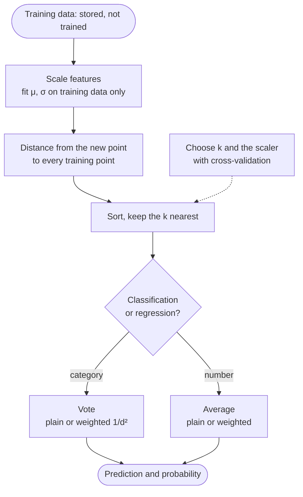
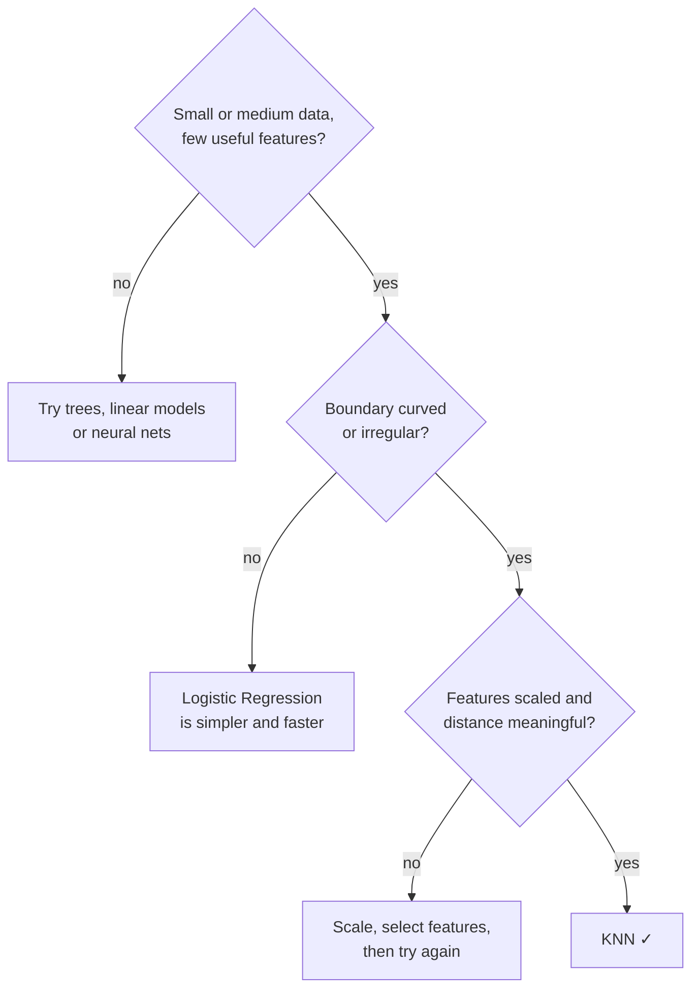

# K-Nearest Neighbors (KNN)

> [!abstract] In one sentence
> To predict a new point, measure its **distance** to every stored example, take the $k$ **nearest** ones, and let them **vote** (classification) or **average** (regression). There is no training step and no weights: the data itself is the model.

![[kn-01-straight-vs-knn.png]]

**Contents**
1. [[#1. Why we need it]]
2. [[#2. Real-life example]]
3. [[#3. Explanation step by step]]
4. [[#4. Many features (vector form)]]
5. [[#5. How good is the model? (evaluation)]]
6. [[#6. Assumptions, limits and fixes]]
7. [[#7. Code]]
8. [[#8. Common mistakes]]
9. [[#9. Summary and cheat sheet]]
10. [[#10. Exercises]]

---

## 1. Why we need it

[[Logistic Regression]] draws **one straight boundary** between the classes. That works only when a line (or flat plane) can separate them. Real data is often messier:

- one class sits in the middle and another surrounds it (as in the picture above),
- a class is split into several islands,
- the boundary is curved or irregular.

KNN makes **no assumption about the shape** of the boundary. It looks at what is around a point and decides from that, so the boundary follows the data wherever it goes.

| Situation | Why KNN helps |
|---|---|
| Curved or irregular boundary | No straight-line assumption |
| You need a quick, honest baseline | Nothing to train, easy to explain |
| "Find similar items" problems (recommendations, similar customers) | Finding the nearest items is exactly what KNN does |
| Small or medium datasets | Works well when there are not millions of rows |

> [!info] Type of problem
> **Supervised learning → classification and regression.** We have inputs $x$ and known answers $y$ (a class, or a number). KNN is a **lazy learner** (also called *instance-based*): it learns no weights, it just **stores** the data and does all its work at prediction time. That is the opposite of [[Linear Regression]] and [[Logistic Regression]], which learn $w$ and $b$ first and then throw the data away.

> [!tip] Does such a simple idea really work?
> Yes. A classic result (Cover and Hart, 1967) says that with enough data, even the plain 1-nearest-neighbour rule makes at most about **twice the error of the best possible classifier**. KNN is simple, but not naive.

---

## 2. Real-life example

**Problem:** predict whether a student passes, from **study hours** and **sleep hours**. Data from 5 past students:

| Student | Study hours | Sleep hours | Result |
|---|---|---|---|
| A | 8 | 7 | Pass |
| B | 7 | 6 | Pass |
| C | 2 | 8 | Fail |
| D | 3 | 5 | Fail |
| E | 5 | 3 | Fail |

**Question:** a new student studies **6 hours** and sleeps **5 hours**. Will they pass?
**Answer at the end:** the three nearest students vote 2 to 1 for Pass, so about 67% (76% with weighted voting). It is a borderline case, and the answer changes with $k$. That is why the note spends time on choosing $k$.

![[kn-02-student-example.png]]

> [!example] Same idea elsewhere
> - **Recommendations:** "people with a taste like yours liked this film".
> - **Medicine:** compare a new patient with the most similar past patients.
> - **House prices (regression):** average the price of the $k$ most similar houses nearby.
> - **Missing values:** fill a gap with the average of the most similar rows (`KNNImputer`).

---

## 3. Explanation step by step

### Overview of the algorithm



We explain the steps in the order that is easiest to learn: distance first, then scaling.

### Notation

| Symbol | Meaning | In our example |
|---|---|---|
| $n$ | number of stored examples | 5 students |
| $m$ | number of features | 2 (study, sleep) |
| $x_i = (x_{i1},\dots,x_{im})$ | features of stored example $i$ | A = (8, 7) |
| $y_i$ | true label (or value) of example $i$ | Pass = 1, Fail = 0 |
| $q$ | the new point to predict | (6, 5) |
| $d_i = d(x_i, q)$ | distance from example $i$ to $q$ | $d_B = 1.41$ |
| $N_k(q)$ | the set of the $k$ nearest examples | $N_3 = \{B, E, A\}$ |
| $\hat y$ | our prediction | |

---

### Step 1 — Measure "how close"

**Plain idea:** two students are similar if their numbers are close, so we turn "close" into one number.

**Euclidean distance** (straight line, the default):

$$d(x_i, q) = \sqrt{\sum_{j=1}^{m} (x_{ij} - q_j)^2}$$

For each feature take the difference, square it, add everything up, then take the square root.

**Manhattan distance** (walk along the grid, like city blocks):

$$d(x_i, q) = \sum_{j=1}^{m} \lvert x_{ij} - q_j \rvert$$

**Minkowski distance** is the general form $d = \left(\sum_j \lvert x_{ij} - q_j \rvert^{p}\right)^{1/p}$. With $p = 2$ it is Euclidean, with $p = 1$ it is Manhattan.

![[kn-03-distances.png]]

**Numbers** for the new student $q = (6, 5)$ (Euclidean):

| Student | Calculation | Distance |
|---|---|---|
| B | $\sqrt{(7-6)^2 + (6-5)^2} = \sqrt{2}$ | 1.41 |
| E | $\sqrt{(5-6)^2 + (3-5)^2} = \sqrt{5}$ | 2.24 |
| A | $\sqrt{(8-6)^2 + (7-5)^2} = \sqrt{8}$ | 2.83 |
| D | $\sqrt{(3-6)^2 + (5-5)^2} = \sqrt{9}$ | 3.00 |
| C | $\sqrt{(2-6)^2 + (8-5)^2} = \sqrt{25}$ | 5.00 |

For C, Manhattan gives $4 + 3 = 7$ while Euclidean gives $5$. The two can rank neighbours differently.

| Distance | Good when |
|---|---|
| Euclidean | Default, few to moderate features |
| Manhattan | Many features, or outliers (it does not square the differences) |
| Cosine, $1 - \dfrac{x \cdot q}{\lVert x \rVert\,\lVert q \rVert}$ | Text and embeddings: compares direction, not length |
| Hamming (share of differing positions) | Categorical features |

> [!tip] A free speed-up
> Squaring is monotonic, so the **ordering** of $d^2$ is the same as the ordering of $d$. Skip the square root when you only need the nearest ones.

> [!info] Step 1 is a formula, Step 2 changes what goes into it
> Whatever numbers you feed in (hours, minutes, or scaled values), the recipe stays the same: gap, square, add, square root. In the real algorithm you scale first and then use this recipe on the scaled numbers.

---

### Step 2 — Scale the features

**Plain idea:** the distance formula adds up gaps. A feature written in bigger numbers has bigger gaps, so it **takes over** the distance, and a feature with small numbers is almost ignored. Scaling puts every feature on the same 0 to 1 ruler. In the real algorithm we scale **first** and then use the Step 1 formula on the scaled numbers.

**Example: the same students, only the unit changes.** Suppose the sleep column was written in **minutes** instead of hours. It is the same sleep, just another unit:

| Student | Study (h) | Sleep (min) | Result |
|---|---|---|---|
| A | 8 | 420 | Pass |
| B | 7 | 360 | Pass |
| C | 2 | 480 | Fail |
| D | 3 | 300 | Fail |
| E | 5 | 180 | Fail |
| New | 6 | 300 | ? |

Apply the Step 1 recipe (gap, square, add, square root). For B:

$$d=\sqrt{(7-6)^2+(360-300)^2}=\sqrt{1+3600}=60.01$$

| Student | Study gap | Sleep gap | Squares | Sum | Distance |
|---|---|---|---|---|---|
| D | $-3$ | $0$ | $9,\ 0$ | 9 | **3.00** |
| B | $1$ | $60$ | $1,\ 3600$ | 3601 | **60.01** |
| E | $-1$ | $-120$ | $1,\ 14400$ | 14401 | **120.00** |
| A | $2$ | $120$ | $4,\ 14400$ | 14404 | **120.02** |
| C | $-4$ | $180$ | $16,\ 32400$ | 32416 | **180.04** |

The sleep minutes take over: in B the sleep part is 3600 and the study part is only 1 (0.03% of the squared distance). The three nearest are now D, B, E, so the vote is **Fail**. With sleep in hours it was **Pass**. Same students, same sleep, and the answer changed only because of the unit. **A unit should never change the answer.**

**Min-max scaling** squeezes every column into 0 to 1:

$$x' = \frac{x - x_{\min}}{x_{\max} - x_{\min}}$$

For study, $x_{\min} = 2$, $x_{\max} = 8$ (range 6). For sleep in minutes, $x_{\min} = 180$, $x_{\max} = 480$ (range 300).

| Student | Study' | Sleep' |
|---|---|---|
| A | $\frac{8-2}{6} = 1.000$ | $\frac{420-180}{300} = 0.800$ |
| B | $\frac{7-2}{6} = 0.833$ | $\frac{360-180}{300} = 0.600$ |
| C | $\frac{2-2}{6} = 0.000$ | $\frac{480-180}{300} = 1.000$ |
| D | $\frac{3-2}{6} = 0.167$ | $\frac{300-180}{300} = 0.400$ |
| E | $\frac{5-2}{6} = 0.500$ | $\frac{180-180}{300} = 0.000$ |
| New | $\frac{6-2}{6} = 0.667$ | $\frac{300-180}{300} = 0.400$ |

Scaling gives only these new numbers. **Now Step 1 is used on them**, with exactly the same recipe:

| Student | Study gap | Sleep gap | Squares | Sum | Distance |
|---|---|---|---|---|---|
| B | $0.167$ | $0.2$ | $0.0278,\ 0.04$ | 0.0678 | **0.26** |
| E | $-0.167$ | $-0.4$ | $0.0278,\ 0.16$ | 0.1878 | **0.43** |
| D | $-0.5$ | $0$ | $0.25,\ 0$ | 0.25 | **0.50** |
| A | $0.333$ | $0.4$ | $0.1111,\ 0.16$ | 0.2711 | **0.52** |
| C | $-0.667$ | $0.6$ | $0.4444,\ 0.36$ | 0.8044 | **0.90** |

![[kn-04-scaling.png]]

Both features now count (for B the study part is 41% of the squared distance and the sleep part 59%). The three nearest are B, E, D, so the vote is Fail by 2 to 1.

> [!info] Why this differs from the Pass in step 4
> With both columns in hours and no scaling, the nearest three were B, E, A (Pass). Scaling also gives both features the same 0 to 1 range, so each feature counts a little differently than before. With 5 students and $k = 3$ this is a borderline case either way. What scaling guarantees is that the answer **no longer depends on the unit**: sleep in hours or in minutes gives exactly the same scaled numbers.

> [!question] Why not stop after scaling?
> The scaled table has two numbers per student, and they point in different directions (D has the same Sleep' as the new student but a far Study', while B is closer in Study' and further in Sleep'). To get **one** number per student and rank them, we need the distance formula of Step 1.

**Z-score (standardization)** is the other common choice (average 0, spread 1):

$$x' = \frac{x - \mu}{\sigma}, \qquad \mu = \frac{1}{n}\sum_i x_i, \quad \sigma = \sqrt{\frac{1}{n}\sum_i (x_i - \mu)^2}$$

Example with the study hours 8, 7, 2, 3, 5: $\mu = 5$, $\sigma = \sqrt{26/5} = 2.28$. So A becomes $\frac{8-5}{2.28} = 1.32$, B $0.88$, C $-1.32$, D $-0.88$, E $0$, and the new student (6 hours) $\frac{6-5}{2.28} = 0.44$. Using z-scores on both columns also gives B, E, D as the three nearest.

| Use | When |
|---|---|
| **Min-max** | Range is naturally fixed (pixels 0 to 255, scores 1 to 5) and there are no strong outliers |
| **Z-score** | A good default when unsure, values roughly bell-shaped, mild outliers |
| **Robust scaler** (median and IQR) | Heavy outliers you cannot remove |

> [!warning] Outliers affect both
> One huge value squeezes the normal points together under min-max. Z-score is hurt less, but still hurt, because the outlier inflates $\sigma$. With heavy outliers use a robust scaler, clip the extremes, or take a log.

> [!warning] Fit the scaler on the training data only
> Compute $x_{\min}, x_{\max}, \mu, \sigma$ from the **training students**, then reuse those same numbers for the new student and for every later prediction. The new student does not change them: study stays at $x_{\min} = 2$, $x_{\max} = 8$, so 6 hours is always $\frac{6-2}{6} = 0.667$. Computing them on all data leaks test information into training and makes your accuracy look better than it really is. A scikit-learn `Pipeline` does this for you (section 7).

When all features already share one unit, as with study and sleep both in **hours**, scaling matters much less and the step 1 distances can be used directly. That is why steps 3 to 6 use the hours table.

---

### Step 3 — Find the $k$ nearest

**Plain idea:** sort by distance and keep the first $k$.

$$N_k(q) = \{\text{the } k \text{ examples with the smallest } d(x_i, q)\}$$

Sorted for our new student:

| Rank | Student | $d$ | Result |
|---|---|---|---|
| 1 | B | 1.41 | Pass |
| 2 | E | 2.24 | Fail |
| 3 | A | 2.83 | Pass |
| 4 | D | 3.00 | Fail |
| 5 | C | 5.00 | Fail |

For $k = 3$: $N_3(q) = \{B, E, A\}$. That is the dashed circle in the picture of section 2.

---

### Step 4 — Vote or average

**Classification (a category): majority vote**

$$\hat y = \underset{c}{\arg\max} \sum_{i \in N_k(q)} \mathbf{1}[\,y_i = c\,]$$

Read it as: for every class $c$, count how many neighbours have that class, then pick the class with the biggest count. $\mathbf{1}[\cdot]$ is 1 when the condition is true and 0 otherwise.

**Probability estimate:**

$$P(\text{Pass} \mid q) = \frac{1}{k} \sum_{i \in N_k(q)} \mathbf{1}[\,y_i = \text{Pass}\,]$$

| $k$ | Neighbours | Pass : Fail | Prediction | $P(\text{Pass})$ |
|---|---|---|---|---|
| 1 | B | 1 : 0 | Pass | 1.00 |
| 3 | B, E, A | 2 : 1 | Pass | 0.67 |
| 5 | B, E, A, D, C | 2 : 3 | **Fail** | 0.40 |

The answer flipped just because $k$ changed. With $k = 3$ the probability can only be $0$, $\frac13$, $\frac23$ or $1$, so it is a rough estimate.

**Regression (a number): average**

$$\hat y = \frac{1}{k} \sum_{i \in N_k(q)} y_i$$

Suppose we also know each student's exam score: A = 85, B = 78, C = 40, D = 50, E = 55. For $k = 3$ the neighbours are B, E, A:

$$\hat y = \frac{78 + 55 + 85}{3} = 72.67$$

> [!info] Ties
> With two classes and an **even** $k$ the vote can tie (for example 2 : 2). Use an **odd** $k$, or break ties with the weighted vote below.

---

### Step 5 — Weighted voting

**Plain idea:** a neighbour at distance 1.4 should matter more than one at distance 3.0, but a plain vote counts them the same. Give each neighbour a weight that **grows as the distance shrinks**:

$$w_i = \frac{1}{d_i^{2}}$$

Classification: add up the weights per class instead of counting votes.

$$P(\text{Pass}) = \frac{\sum_{i \in N_k} w_i\,\mathbf{1}[y_i = \text{Pass}]}{\sum_{i \in N_k} w_i}$$

Regression:

$$\hat y = \frac{\sum_{i \in N_k} w_i\, y_i}{\sum_{i \in N_k} w_i}$$

**Numbers:**

| Student | $d$ | $d^2$ | $w = 1/d^2$ |
|---|---|---|---|
| B | 1.41 | 2 | 0.500 |
| E | 2.24 | 5 | 0.200 |
| A | 2.83 | 8 | 0.125 |
| D | 3.00 | 9 | 0.111 |
| C | 5.00 | 25 | 0.040 |

For $k = 5$ (plain voting said Fail):
- Pass weight $= 0.500 + 0.125 = 0.625$
- Fail weight $= 0.200 + 0.111 + 0.040 = 0.351$
- Pass wins, and $P(\text{Pass}) = \dfrac{0.625}{0.976} \approx 0.64$

For $k = 3$: $P(\text{Pass}) = \dfrac{0.625}{0.825} \approx 0.76$.

Regression with $k = 3$: $\hat y = \dfrac{0.5 \cdot 78 + 0.2 \cdot 55 + 0.125 \cdot 85}{0.825} = 73.48$, compared with $72.67$ for the plain average.

![[kn-05-weighted-vote.png]]

At $k = 5$ plain voting says **Fail** and weighted voting says **Pass**, because the two Pass points are close and the Fail points are far. Weighting also makes the result less sensitive to the exact choice of $k$.

> [!warning] Division by zero
> If the new point is **exactly** on a stored point, $d = 0$ and $1/d^2$ blows up. Libraries handle this case separately (the exact match wins).

---

### Step 6 — Choose $k$

$k$ is the one real setting in KNN. It controls how flexible the model is.

| | Small $k$ (like 1) | Large $k$ (like 100) |
|---|---|---|
| Boundary | Wiggly | Smooth |
| Behaviour | Follows noise: **overfits** | Ignores local detail: **underfits** |
| Risk | One odd point flips nearby predictions | Big classes drown out small ones |

The extreme cases: at $k = 1$ the **training accuracy is always 100%** (every point is its own nearest neighbour), and at $k = n$ every prediction is simply the overall majority class.

![[kn-06-effect-of-k.png]]

So we **never choose $k$ on training data**. We test many values on data the model has not seen.

**Cross-validation, step by step:**

1. Split the training data into $F$ folds (for example 5).
2. For each fold: treat it as validation, use the other folds as the stored data, and measure the error.
3. Average over the folds:

$$\text{CV error}(k) = \frac{1}{F} \sum_{f=1}^{F} \frac{1}{\lvert V_f \rvert} \sum_{i \in V_f} \mathbf{1}[\,\hat y_i \neq y_i\,]$$

4. Repeat for $k = 1, 3, 5, \dots$ and keep the best:

$$k^{*} = \underset{k}{\arg\min}\ \text{CV error}(k)$$

![[kn-07-choosing-k.png]]

In this example (200 noisy points) the cross-validation accuracy peaks near $k = 13$, while the training accuracy is highest at $k = 1$. The best $k$ **depends on the data**, so do not copy this number.

A common first guess is $k \approx \sqrt{n}$, and an odd $k$ avoids ties.

> [!warning] Only 5 students
> With 5 students we cannot choose $k$ properly: there is nothing to validate on, and $k = 5$ means "use all the data". $k = 3$ in this note is a teaching choice, small and odd, and nothing more.

---

### Answer to the real-life question

The new student (6 h study, 5 h sleep):

| Method | $k$ | Result |
|---|---|---|
| Plain vote | 3 | Pass, $P = 0.67$ |
| Weighted vote | 3 | Pass, $P = 0.76$ |
| Plain vote | 5 | Fail, $P = 0.40$ |
| Weighted vote | 5 | Pass, $P = 0.64$ |

Three of four settings say **Pass**, with a probability between 0.64 and 0.76. A prediction that depends on $k$ means the student sits close to the decision boundary. Report the probability, not only the label, and be honest that this is a **borderline case** with only 5 examples.

---

## 4. Many features (vector form)

With $m$ features, a point is a vector $\mathbf{x} \in \mathbb{R}^m$ and Euclidean distance is the length of the difference:

$$d(\mathbf{x}_i, \mathbf{q}) = \lVert \mathbf{x}_i - \mathbf{q} \rVert_2 = \sqrt{(\mathbf{x}_i - \mathbf{q})^\top (\mathbf{x}_i - \mathbf{q})}$$

In NumPy, with all stored points in a matrix $X$ of shape $n \times m$, one line computes every distance at once:

```python
d = np.sqrt(((X - q) ** 2).sum(axis=1))
```

- **Cosine distance:** $d = 1 - \cos\theta = 1 - \dfrac{\mathbf{x}\cdot\mathbf{q}}{\lVert\mathbf{x}\rVert\,\lVert\mathbf{q}\rVert}$. Normalising the vectors first makes it equivalent to Euclidean ranking.
- **Mixed features:** scale the numeric ones, one-hot encode the categories, or use a distance made for mixed data.
- **More than two classes:** nothing changes. Count (or weigh) the votes per class and take the largest. $P(c) = \frac{\text{votes for } c}{k}$ gives one probability per class.
- **Cost:** one prediction compares against all $n$ stored points with $m$ features, so it costs about $n \times m$ operations.

The curse of dimensionality (section 6) is the reason many features hurt KNN more than most other models.

---

## 5. How good is the model? (evaluation)

KNN's **training accuracy is misleading**: at $k = 1$ it is always perfect. Evaluate on **held-out data** or with **cross-validation**, and keep a final test set that you touch only once.

Example: 300 noisy points (two interleaved half-moons), 75 kept as a test set, $k$ and the weighting chosen by 5-fold cross-validation on the other 225 (code in section 7). Best choice: $k = 9$, plain voting, with cross-validation accuracy 0.884.

On the held-out test set:

| | Predicted class 0 | Predicted class 1 |
|---|---|---|
| **Actually class 0** | 31 (TN) | 7 (FP) |
| **Actually class 1** | 5 (FN) | 32 (TP) |

| Metric | Formula | Value |
|---|---|---|
| Accuracy | $(TP + TN)/n$ | 0.84 |
| Precision | $TP/(TP + FP)$ | 0.82 |
| Recall | $TP/(TP + FN)$ | 0.86 |
| F1 | harmonic mean of precision and recall | 0.84 |

For **regression** use MAE, RMSE or $R^2$ on held-out data.

**Choosing the threshold:** KNN gives $P(\text{class})$, so you can move the cut-off from 0.5, as with [[Logistic Regression]]. Use a lower threshold when missing a real case is costly.

> [!warning] Small data
> The 5-student numbers in section 3 only illustrate the formulas. Always evaluate on held-out data, and report the uncertainty (a different split can change the result).

---

## 6. Assumptions, limits and fixes

### Assumptions
- **Nearby points have similar labels** (the output changes smoothly with the inputs).
- The **distance is meaningful**: the features are on comparable scales and actually relate to the answer.
- The stored data is **representative** of the new points.

### Limit 1 — Unscaled features
A big-number feature dominates the distance (section 3, step 2). **Fix:** scale inside a pipeline, fit on training data only.

### Limit 2 — The curse of dimensionality
With many features, points are spread so thin that nobody is really "near" anybody. If data is spread evenly in a unit cube, the side length of a smaller cube that holds a fraction $r$ of the points is $r^{1/m}$. For a neighbourhood with 10% of the data:

| Features $m$ | Side length $0.1^{1/m}$ |
|---|---|
| 1 | 0.10 |
| 2 | 0.32 |
| 10 | 0.79 |
| 100 | 0.98 |

At 100 features "nearby" covers 98% of the range along every feature. Also, the gap between the nearest and the farthest point shrinks: $\dfrac{d_{\max} - d_{\min}}{d_{\min}} \to 0$ as $m$ grows. "Nearest" then carries little information.

![[kn-08-curse-of-dimensionality.png]]

**Fix:** remove useless features, reduce dimensions (PCA), collect more data, or try cosine distance.

### Limit 3 — Slow predictions and large memory
Nothing is learned, so every prediction searches all $n$ points, and the whole dataset must stay in memory. **Fix:** KD-trees or ball trees (`algorithm="auto"` in scikit-learn), approximate nearest-neighbour search for millions of rows, or fewer stored points.

### Limit 4 — Imbalanced classes
If 95% of the points are "no", the neighbours are mostly "no" and rare cases get outvoted. **Fix:** distance weighting, class balancing, a lower probability threshold, and precision/recall instead of accuracy.

### Limit 5 — Noise and irrelevant features
Irrelevant features add random distance, and outliers can become wrong neighbours. **Fix:** feature selection, a larger $k$, cleaning outliers.

### Limit 6 — Missing values and categories
Distances need numbers. **Fix:** impute missing values first, and one-hot encode categories or use Hamming distance.

### When to use it



---

## 7. Code

### 7a. From scratch — NumPy

```python
import numpy as np

X = np.array([[8, 7], [7, 6], [2, 8], [3, 5], [5, 3]], dtype=float)  # study, sleep
y = np.array([1, 1, 0, 0, 0])                          # 1 = pass, 0 = fail
scores = np.array([85, 78, 40, 50, 55], dtype=float)   # for the regression example
q = np.array([6, 5], dtype=float)                      # new student

def knn(X, y, q, k=3, weighted=False):
    d = np.sqrt(((X - q) ** 2).sum(axis=1))            # Step 1: distance to everyone
    idx = np.argsort(d)[:k]                            # Step 3: k nearest
    w = 1 / d[idx] ** 2 if weighted else np.ones(k)    # Step 5: weights (1 = plain vote)
    p_pass = w[y[idx] == 1].sum() / w.sum()            # Step 4: (weighted) share of Pass
    return p_pass, d, idx

def knn_regress(X, targets, q, k=3, weighted=False):
    d = np.sqrt(((X - q) ** 2).sum(axis=1))
    idx = np.argsort(d)[:k]
    w = 1 / d[idx] ** 2 if weighted else np.ones(k)
    return (w * targets[idx]).sum() / w.sum()

for k in (1, 3, 5):
    p, d, idx = knn(X, y, q, k)
    print(k, round(p, 2), "Pass" if p > 0.5 else "Fail")
# 1 1.0 Pass
# 3 0.67 Pass
# 5 0.4 Fail

print(np.round(d, 2))                                  # [2.83 1.41 5.   3.   2.24]
print(round(knn(X, y, q, 3, weighted=True)[0], 2))     # 0.76
print(round(knn(X, y, q, 5, weighted=True)[0], 2))     # 0.64
print(round(knn_regress(X, scores, q, 3), 2))          # 72.67
print(round(knn_regress(X, scores, q, 3, True), 2))    # 73.48
```

### 7b. scikit-learn (what you use in practice)

```python
from sklearn.neighbors import KNeighborsClassifier
from sklearn.pipeline import make_pipeline
from sklearn.preprocessing import StandardScaler
from sklearn.datasets import make_moons
from sklearn.model_selection import train_test_split, GridSearchCV
from sklearn.metrics import confusion_matrix, classification_report

# the 5 students (both features are hours, so no scaling here)
m = KNeighborsClassifier(n_neighbors=3).fit(X, y)
print(m.predict_proba([[6, 5]]))      # [[0.333 0.667]]  -> [P(fail), P(pass)]
print(m.predict([[6, 5]]))            # [1]

# a bigger dataset: scale, then choose k and the weighting by cross-validation
Xm, ym = make_moons(n_samples=300, noise=0.3, random_state=3)
X_tr, X_te, y_tr, y_te = train_test_split(Xm, ym, test_size=0.25, random_state=0, stratify=ym)

pipe = make_pipeline(StandardScaler(), KNeighborsClassifier())   # scaler is fit inside each fold
grid = GridSearchCV(
    pipe,
    {"kneighborsclassifier__n_neighbors": range(1, 52, 2),       # odd k only
     "kneighborsclassifier__weights": ["uniform", "distance"]},
    cv=5,
)
grid.fit(X_tr, y_tr)
print(grid.best_params_, round(grid.best_score_, 3))
# {'kneighborsclassifier__n_neighbors': 9, 'kneighborsclassifier__weights': 'uniform'} 0.884

y_hat = grid.predict(X_te)
print(round(grid.score(X_te, y_te), 3))   # 0.84
print(confusion_matrix(y_te, y_hat))      # [[31  7]
                                          #  [ 5 32]]
print(classification_report(y_te, y_hat, digits=2))
```

For regression use `KNeighborsRegressor` in the same way.

> [!tip] `weights="distance"` is not our $1/d^2$
> scikit-learn's `weights="distance"` uses $1/d$. On the 5 students with $k = 5$ it gives $P(\text{Pass}) = 0.52$, while our $1/d^2$ gives $0.64$. For $1/d^2$ pass a function: `weights=lambda d: 1 / d**2`.

> [!tip] Defaults
> `KNeighborsClassifier()` uses `n_neighbors=5`, Euclidean distance (`metric="minkowski", p=2`) and plain voting. Other useful options: `metric="manhattan"`, `algorithm="kd_tree"`, `RadiusNeighborsClassifier` (all points within a radius instead of a fixed $k$).

---

## 8. Common mistakes

> [!bug] Watch out for these
> - **Forgetting to scale.** The biggest-number feature silently decides everything.
> - **Fitting the scaler on all the data** instead of the training data only.
> - **Choosing $k$ on the training set.** $k = 1$ always looks perfect there.
> - **An even $k$** for two classes, which allows ties.
> - **Too many features** (or irrelevant ones). Select features first.
> - **Treating $P(\text{Pass}) = 0.67$ as certainty.** With $k = 3$ it is only a count of votes.
> - **Always using 0.5** as the cut-off on imbalanced data.
> - **Using KNN on huge data** without a tree or approximate index.
> - **Forgetting that categories need encoding** before computing distances.
> - **Thinking KNN "trains".** It stores the data. The cost arrives at prediction time.

---

## 9. Summary and cheat sheet

| Item | Formula |
|---|---|
| Euclidean distance | $d = \sqrt{\sum_j (x_{ij} - q_j)^2}$ |
| Manhattan distance | $d = \sum_j \lvert x_{ij} - q_j \rvert$ |
| Min-max scaling | $x' = \dfrac{x - x_{\min}}{x_{\max} - x_{\min}}$ |
| Z-score | $x' = \dfrac{x - \mu}{\sigma}$ |
| Neighbours | $N_k(q)$ = the $k$ smallest $d_i$ |
| Class (plain vote) | $\hat y = \arg\max_c \sum_{i \in N_k} \mathbf{1}[y_i = c]$ |
| Probability | $P(c) = \dfrac{\text{neighbours of class } c}{k}$ |
| Regression | $\hat y = \dfrac{1}{k}\sum_{i \in N_k} y_i$ |
| Weight | $w_i = 1/d_i^2$ |
| Weighted class | $\arg\max_c \sum_{i \in N_k} w_i\,\mathbf{1}[y_i = c]$ |
| Weighted regression | $\hat y = \dfrac{\sum w_i y_i}{\sum w_i}$ |
| Best $k$ | $k^{*} = \arg\min_k \text{CV error}(k)$ |
| Hypercube for fraction $r$ | $s = r^{1/m}$ |

**Key ideas to remember**
1. KNN **stores** the data and predicts by asking the $k$ **closest** examples. There is no training.
2. It assumes **no shape** for the boundary, which is its strength.
3. Everything depends on the **distance**, so **scale the features** first (fit on training data only).
4. Classes **vote**, numbers are **averaged**. Weighting by $1/d^2$ lets closer neighbours count more.
5. **Small $k$ overfits, large $k$ underfits.** Choose an odd $k$ with cross-validation, never on training data.
6. It struggles with **many features**, **large data** and **imbalanced classes**.

> [!quote] Sources
> - T. Cover and P. Hart, *Nearest neighbor pattern classification*, IEEE Transactions on Information Theory, 1967 (the error bound).
> - K. Beyer, J. Goldstein, R. Ramakrishnan, U. Shaft, *When is "nearest neighbor" meaningful?*, ICDT 1999 (distances concentrate in high dimensions).
> - scikit-learn user guide, [Nearest Neighbors](https://scikit-learn.org/stable/modules/neighbors.html) (options and algorithms).
>
> The 5-student example and all numbers in this note are my own illustration, computed with the code in section 7. The moons results use `random_state=3` and `random_state=0`.

---

## 10. Exercises

- [ ] Compute the distance from a new student $(4, 4)$ to all five students. Which three are nearest, and what does a $k = 3$ vote say?
- [ ] Compute the Manhattan distance from $q = (6, 5)$ to all five students. Does the order of the neighbours change?
- [ ] Redo the sleep-in-minutes example with z-scores instead of min-max. Which student is nearest, and which three vote?
- [ ] Add a student F = (6, 4) who passed. Re-run the code. How do $k = 3$ and $k = 5$ change?
- [ ] Compute $P(\text{Pass})$ at $k = 4$ by hand with plain voting (there is a tie) and with $1/d^2$ weights.
- [ ] Change the code to use Manhattan distance, and compare with `KNeighborsClassifier(metric="manhattan")`.
- [ ] On the moons data, plot cross-validation accuracy against $k$ with and without `StandardScaler`. Does scaling matter here?
- [ ] Add 20 columns of random noise to the moons data and watch the accuracy fall. Then explain it with the curse of dimensionality.
- [ ] Use `KNeighborsRegressor` to predict the exam score of the new student from the five known scores.
- [ ] Compare KNN with [[Logistic Regression]] on `make_circles`. Which wins, and why?

---

**Previous algorithm:** [[Logistic Regression]]
