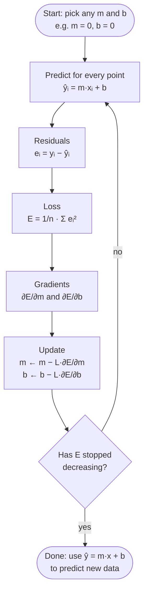
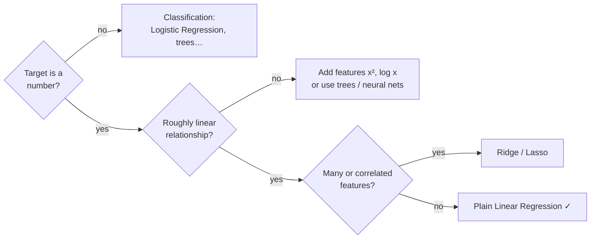

# Linear Regression

> [!abstract] In one sentence
> Choose a straight line $\hat{y} = m x + b$, measure how wrong it is with the **Mean Squared Error**, use the **derivatives** to find which way is downhill, and step that way until the error stops shrinking.

![[lr-01-best-fit.png]]

**Contents**
1. [[#1. Why we need it]]
2. [[#2. Real-life example]]
3. [[#3. Explanation step by step]]
4. [[#4. Many features (matrix form)]]
5. [[#5. How good is the model? (evaluation)]]
6. [[#6. Assumptions, limits and fixes]]
7. [[#7. Code]]
8. [[#8. Common mistakes]]
9. [[#9. Summary and cheat sheet]]
10. [[#10. Exercises]]

---

## 1. Why we need it

Many real decisions depend on predicting a **number**:
- What will this flat rent for?
- How many units will we sell next month?
- What score will a student get?

You could guess a rule by hand ("every study hour adds 5 points"), but you don't know the right numbers, and with several factors guessing stops working. **Linear regression learns the rule from past data.**

| Reason | What it means |
|---|---|
| Simple and fast | Trains in milliseconds, even on large data |
| Interpretable | Each weight = how much the output changes when that input goes up by 1 |
| Foundation | Loss functions, gradient descent and overfitting all start here; a neural network is many linear models stacked with non-linear functions in between |
| Baseline | Before using a complex model, check that it actually beats linear regression |

> [!info] Type of problem
> **Supervised learning → regression.** We have inputs $x$ and a known numeric answer $y$ for past examples, and we want to predict $y$ for new $x$.

---

## 2. Real-life example

**Problem:** a teacher wants to predict exam scores from study time. Data from 8 past students:

| Study hours $x$ | 1 | 2 | 3 | 4 | 5 | 6 | 7 | 8 |
|---|---|---|---|---|---|---|---|---|
| Exam score $y$ | 52 | 55 | 61 | 60 | 70 | 74 | 77 | 85 |

**Question:** a new student will study **10 hours**. What score should we expect?

The points rise roughly along a straight line. If we find the best line, we can read off the prediction. **Answer at the end: ≈ 92 points.**

> [!example] Same idea with many inputs
> A landlord predicts rent from size (m²) and distance to the centre (km):
> $$\text{rent} \approx 200 + 12\cdot\text{size} - 25\cdot\text{distance}$$
> A 60 m² flat, 4 km out: $200 + 720 - 100 = €820$. Each extra m² adds about €12; each km away costs about €25.

---

## 3. Explanation step by step

### Overview of the training loop



### Notation

| Symbol | Meaning | In our example |
|---|---|---|
| $n$ | number of data points | 8 students |
| $x_i$ | input of point $i$ | study hours |
| $y_i$ | true output of point $i$ | real exam score |
| $\hat{y}_i$ ("y-hat") | predicted output | score the line predicts |
| $m$ | slope | points per extra hour |
| $b$ | intercept | predicted score at 0 hours |
| $\bar{x}$, $\bar{y}$ ("x-bar", "y-bar") | **averages** of all $x$ and all $y$ | 4.5 and 66.75 |
| $L$ (also $\alpha$) | learning rate | step size, e.g. 0.02 |
| $\Sigma$ | sum over all points $i = 1 \dots n$ | |

---

### Step 1 — The model: a straight line

$$\hat{y} = m\,x + b$$

- **m (slope):** how much $\hat{y}$ changes when $x$ goes up by 1.
- **b (intercept):** the value of $\hat{y}$ when $x = 0$.

Every choice of $m$ and $b$ is a different line. **Learning = finding the $m$ and $b$ that fit the data best.**

---

### Step 2 — The error of one point (residual)

$$e_i = y_i - \hat{y}_i = y_i - (m x_i + b)$$

It is the **vertical distance** between the point and the line (red dashed lines in the first chart).
- $e_i > 0$: the line is too low at that point.
- $e_i < 0$: the line is too high.

---

### Step 3 — The total error: Mean Squared Error (MSE)

$$E(m, b) = \frac{1}{n}\sum_{i=1}^{n}\left(y_i - \hat{y}_i\right)^2 = \frac{1}{n}\sum_{i=1}^{n}\left(y_i - m x_i - b\right)^2$$

**Why square the errors?**
1. Positive and negative errors can't cancel ($+5$ and $-5$ would add to 0).
2. Big errors are punished much more: an error of 10 counts 100 times more than an error of 1.
3. The result is a smooth **bowl**, so calculus finds the minimum easily.

> [!note]- Deeper reason (click to expand): MSE = maximum likelihood
> Assume the data was generated as $y_i = m x_i + b + \varepsilon_i$ with Gaussian noise $\varepsilon_i \sim \mathcal{N}(0, \sigma^2)$.
> The likelihood of the data is
> $$\mathcal{L}(m,b) = \prod_{i=1}^{n} \frac{1}{\sqrt{2\pi\sigma^2}} \exp\!\left(-\frac{(y_i - m x_i - b)^2}{2\sigma^2}\right)$$
> Taking the log:
> $$\log \mathcal{L} = -\frac{n}{2}\log(2\pi\sigma^2) - \frac{1}{2\sigma^2}\sum_{i}(y_i - m x_i - b)^2$$
> Only the last term depends on $m$ and $b$. So **maximizing the likelihood = minimizing the sum of squared errors.** MSE is not an arbitrary choice.

**Squared errors drawn as real squares:** each red square has side $|e_i|$, so its area is $e_i^2$. MSE is the **average area**. Finding the best line = making the squares as small as possible.

![[lr-02-squared-errors.png]]

**Worked example — guess line $m = 5,\ b = 40$:**

| $x$ | 1 | 2 | 3 | 4 | 5 | 6 | 7 | 8 |
|---|---|---|---|---|---|---|---|---|
| $y$ | 52 | 55 | 61 | 60 | 70 | 74 | 77 | 85 |
| $\hat{y} = 5x + 40$ | 45 | 50 | 55 | 60 | 65 | 70 | 75 | 80 |
| $e = y - \hat{y}$ | 7 | 5 | 6 | 0 | 5 | 4 | 2 | 5 |
| $e^2$ | 49 | 25 | 36 | 0 | 25 | 16 | 4 | 25 |

$$E = \frac{180}{8} = 22.5$$

The best line (found below) has $E \approx 3.77$.

---

### Step 4 — Which direction improves the line? (partial derivatives)

$E$ depends on two numbers, $m$ and $b$. The **partial derivative** tells us how $E$ changes when we nudge one of them.

**Chain rule** on one term $e_i^2 = (y_i - m x_i - b)^2$:
- outer derivative: $2\,e_i$
- inner derivative w.r.t. $m$: $\dfrac{\partial e_i}{\partial m} = -x_i$
- inner derivative w.r.t. $b$: $\dfrac{\partial e_i}{\partial b} = -1$

So:

$$\boxed{\frac{\partial E}{\partial m} = -\frac{2}{n}\sum_{i=1}^{n} x_i\,\big(y_i - (m x_i + b)\big)}$$

$$\boxed{\frac{\partial E}{\partial b} = -\frac{2}{n}\sum_{i=1}^{n} \big(y_i - (m x_i + b)\big)}$$

> [!tip] How to read a derivative
> - Negative → increasing that parameter **lowers** the error.
> - Positive → decreasing that parameter lowers the error.
> - Zero → you are at the bottom (flat ground).
>
> The derivative points **uphill**, so we step in the **opposite** direction.

---

### Step 5 — Gradient descent (the update rule)

Start anywhere, then repeat:

$$m \leftarrow m - L\cdot\frac{\partial E}{\partial m} \qquad\qquad b \leftarrow b - L\cdot\frac{\partial E}{\partial b}$$

**Analogy:** you stand on a hill in thick fog. You feel which way the ground slopes under your feet and take a small step downhill. Repeat until the ground is flat.

**The error surface is a bowl.** Each spot $(m, b)$ is one line; the colour is its error. Gradient descent walks from the start to the bottom:

![[lr-03-loss-surface.png]]

> [!question] Why does the path first shoot to the right (m ≈ 13)?
> At the start, $\partial E/\partial m$ is much larger than $\partial E/\partial b$, because it is multiplied by $x_i$ (up to 8). So the slope reacts much faster than the intercept and overshoots. Then $b$ slowly climbs and $m$ comes back. The long, narrow valley is why convergence is slow at the end.

#### The learning rate $L$

| $L$ | What happens |
|---|---|
| Too small | Stable but very slow — needs thousands of steps |
| Good | Error drops quickly and settles at the minimum |
| Too large | Every step overshoots; the error **explodes** (diverges) |

![[lr-04-learning-rate.png]]

> [!warning] Stability limit
> Gradient descent converges only if $0 < L < 2/\lambda_{\max}$, where $\lambda_{\max}$ is the largest eigenvalue of $\frac{2}{n}X^\top X$. For our data that is about $L < 0.038$. With raw, unscaled features $\lambda_{\max}$ can be huge, which is why many tutorials use tiny rates like $0.0001$.
> **Fix:** standardize the features first ($x' = (x - \bar{x}) / \sigma_x$). Then larger rates (0.01–0.1) work and convergence is much faster.

---

### Step 6 — One gradient-descent step by hand

Start from the guess $m = 5,\ b = 40$ with $L = 0.01$. Errors from Step 3: $7, 5, 6, 0, 5, 4, 2, 5$.

$$\sum e_i = 34 \qquad \sum x_i e_i = 7 + 10 + 18 + 0 + 25 + 24 + 14 + 40 = 138$$

$$\frac{\partial E}{\partial m} = -\frac{2}{8}\cdot 138 = -34.5 \qquad \frac{\partial E}{\partial b} = -\frac{2}{8}\cdot 34 = -8.5$$

Update:

$$m = 5 - 0.01\cdot(-34.5) = 5.345 \qquad b = 40 - 0.01\cdot(-8.5) = 40.085$$

New error: $E \approx 13.2$ (was 22.5). **One step cut the error by 41%.**

> [!note] Why did m go *up*?
> The best slope is 4.64, lower than 5. But $b$ is still far too low, and right now raising the slope is the fastest way to lift the line. Over many steps $b$ climbs and $m$ comes back down.

---

### Step 7 — The exact answer (no iteration needed)

At the bottom of the bowl the ground is **flat**, so both derivatives are zero. Instead of walking there, we solve directly:

$$\frac{\partial E}{\partial b} = 0 \quad\text{and}\quad \frac{\partial E}{\partial m} = 0$$

#### 7a. Formula for b

$$-\frac{2}{n}\sum (y_i - m x_i - b) = 0 \;\Rightarrow\; \sum y_i - m\sum x_i - n\,b = 0$$

Divide by $n$ (and use $\bar{y} = \frac{1}{n}\sum y_i$, $\bar{x} = \frac{1}{n}\sum x_i$):

$$\bar{y} - m\bar{x} - b = 0 \;\Rightarrow\; \boxed{b = \bar{y} - m\,\bar{x}}$$

> [!important] Meaning
> Put $x = \bar{x}$ into the line: $m\bar{x} + b = \bar{y}$. **The best line always passes through the average point $(\bar{x}, \bar{y})$** — the purple ✖ in the first chart.

#### 7b. Formula for m

$$-\frac{2}{n}\sum x_i\,(y_i - m x_i - b) = 0$$

Substitute $b = \bar{y} - m\bar{x}$:

$$\sum x_i\big[(y_i - \bar{y}) - m\,(x_i - \bar{x})\big] = 0 \;\Rightarrow\; m = \frac{\sum x_i (y_i - \bar{y})}{\sum x_i (x_i - \bar{x})}$$

Because deviations from the mean add up to zero ($\sum (y_i - \bar{y}) = 0$ and $\sum(x_i - \bar{x}) = 0$), we may replace $x_i$ in front by $(x_i - \bar{x})$:

$$\boxed{m = \frac{\sum (x_i - \bar{x})(y_i - \bar{y})}{\sum (x_i - \bar{x})^2}}$$

- **Top:** how $x$ and $y$ move **together** (positive when above-average hours come with above-average scores).
- **Bottom:** how **spread out** $x$ is.
- **Ratio:** "points per hour".

#### 7c. Calculate it

**Averages** (sum ÷ count):

$$\bar{x} = \frac{1+2+\dots+8}{8} = \frac{36}{8} = 4.5 \qquad \bar{y} = \frac{52+55+61+60+70+74+77+85}{8} = \frac{534}{8} = 66.75$$

| $x$ | $y$ | $x - \bar{x}$ | $y - \bar{y}$ | $(x - \bar{x})(y - \bar{y})$ | $(x - \bar{x})^2$ |
|---|---|---|---|---|---|
| 1 | 52 | −3.5 | −14.75 | 51.625 | 12.25 |
| 2 | 55 | −2.5 | −11.75 | 29.375 | 6.25 |
| 3 | 61 | −1.5 | −5.75 | 8.625 | 2.25 |
| 4 | 60 | −0.5 | −6.75 | 3.375 | 0.25 |
| 5 | 70 | 0.5 | 3.25 | 1.625 | 0.25 |
| 6 | 74 | 1.5 | 7.25 | 10.875 | 2.25 |
| 7 | 77 | 2.5 | 10.25 | 25.625 | 6.25 |
| 8 | 85 | 3.5 | 18.25 | 63.875 | 12.25 |
| **Σ** | | | | **195** | **42** |

$$m = \frac{195}{42} \approx 4.643 \qquad b = 66.75 - 4.643 \times 4.5 \approx 45.857$$

$$\boxed{\hat{y} = 4.643\,x + 45.857}$$

**Check:** $4.643 \times 4.5 + 45.857 = 66.75 = \bar{y}$ ✓

#### 7d. Answer to the real-life question

$$\hat{y}(10) = 4.643 \times 10 + 45.857 \approx \mathbf{92.3 \text{ points}}$$

**Interpretation:** each extra hour is worth ≈ 4.6 points; a student who does not study is predicted at ≈ 46.

> [!caution] Extrapolation
> A model is only trustworthy near the data it learned from. For 30 hours the line predicts $4.643 \cdot 30 + 45.857 \approx 185$ points — impossible.

#### Gradient descent vs. exact formula

| | Exact formula (normal equation) | Gradient descent |
|---|---|---|
| Iterations | none — one calculation | many steps |
| Hyperparameters | none | learning rate, number of steps |
| Cost | $O(p^3)$ matrix inversion → slow with many features | cheap per step, scales to millions of rows |
| Used in | small/medium problems, scikit-learn `LinearRegression` | big data, SGD, **all neural networks** |

Both give the same answer: gradient descent from $(0, 0)$ with $L = 0.02$ ends at $m = 4.643,\ b = 45.857$.

---

## 4. Many features (matrix form)

With $p$ inputs the line becomes a plane (hyperplane):

$$\hat{y} = w_0 + w_1 x_1 + w_2 x_2 + \dots + w_p x_p$$

Put all data in a **design matrix** $X$ ($n$ rows, $p+1$ columns; the first column is all 1s for the intercept):

$$\hat{\mathbf{y}} = X\mathbf{w} \qquad E(\mathbf{w}) = \frac{1}{n}\,\lVert \mathbf{y} - X\mathbf{w} \rVert^2$$

**Gradient:**

$$\nabla E = \frac{2}{n}\,X^\top (X\mathbf{w} - \mathbf{y}) \qquad \mathbf{w} \leftarrow \mathbf{w} - L\,\nabla E$$

**Normal equation** (set gradient to 0):

$$X^\top X\,\mathbf{w} = X^\top \mathbf{y} \;\Rightarrow\; \boxed{\mathbf{w} = (X^\top X)^{-1} X^\top \mathbf{y}}$$

> [!tip] Your $m$ and $b$ are just $w_1$ and $w_0$
> For one feature the matrix formula reduces exactly to the formulas in Step 7.

> [!note]- Extra theory (click to expand)
> - **Convex:** the Hessian $\frac{2}{n}X^\top X$ is positive semi-definite, so there is no local minimum except the global one.
> - **Geometry:** $\hat{\mathbf{y}} = X\mathbf{w}$ is the **orthogonal projection** of $\mathbf{y}$ onto the column space of $X$. The residuals are perpendicular to every feature: $X^\top(\mathbf{y} - \hat{\mathbf{y}}) = 0$. Hat matrix: $H = X(X^\top X)^{-1}X^\top$.
> - **Statistics:** OLS is unbiased, $\mathbb{E}[\hat{\mathbf{w}}] = \mathbf{w}^*$, with variance $\sigma^2 (X^\top X)^{-1}$. By the **Gauss–Markov theorem** it is the Best Linear Unbiased Estimator (BLUE).
> - **Noise estimate:** $\hat{\sigma}^2 = \text{RSS} / (n - p - 1)$.
> - **Not invertible** ($X^\top X$ singular) when features are perfectly collinear or $p + 1 > n$. Fix: pseudo-inverse or Ridge.

---

## 5. How good is the model? (evaluation)

| Metric | Formula | Meaning | Our model |
|---|---|---|---|
| MSE | $\frac{1}{n}\sum (y_i - \hat{y}_i)^2$ | average squared error | 3.77 |
| RMSE | $\sqrt{\text{MSE}}$ | typical error, **same units as $y$** | 1.94 points |
| MAE | $\frac{1}{n}\sum \lvert y_i - \hat{y}_i \rvert$ | average absolute error, less sensitive to outliers | — |
| R² | $1 - \dfrac{\sum (y_i - \hat{y}_i)^2}{\sum (y_i - \bar{y})^2}$ | share of variance explained (1 = perfect, 0 = no better than the mean) | $1 - 30.1/935.5 \approx$ **0.97** |

**Reading:** a typical prediction is off by about 2 points, and study time explains about 97 % of the differences in scores.

> [!warning] Always evaluate on unseen data
> Split data into **train** and **test** sets. On training data, R² never goes down when you add a feature, so it can hide overfitting.

---

## 6. Assumptions, limits and fixes

### Assumptions

| Assumption | Violation looks like | How to check |
|---|---|---|
| Linearity (linear **in the weights**) | curved pattern in residuals | residual vs. fitted plot |
| Independent errors | correlated residuals (time series) | Durbin–Watson test |
| Constant variance (homoscedasticity) | fan-shaped residuals | residual plot, Breusch–Pagan |
| Normal errors (only needed for confidence intervals/tests) | heavy tails | Q–Q plot |
| No perfect multicollinearity | unstable, huge weights | VIF, condition number |

### Limit 1 — Outliers

Because errors are **squared**, one extreme point pulls the whole line. Here a single student with 2 hours → 95 points halves the slope:

![[lr-05-outlier.png]]

**Fixes:** inspect and clean data, use MAE / Huber loss, or robust regression.

### Limit 2 — Curved relationships

A straight line cannot follow a curve (**underfitting**):

![[lr-06-nonlinear.png]]

**Fix:** add features such as $x^2$, $\log x$ → **polynomial regression**. It is still *linear regression*, because the model is linear in the weights. Or use a non-linear model (trees, neural networks).

### Limit 3 — Many / correlated features → Regularization

| | Ridge (L2) | Lasso (L1) |
|---|---|---|
| Loss | $\lVert \mathbf{y} - X\mathbf{w}\rVert^2 + \lambda \lVert \mathbf{w} \rVert_2^2$ | $\lVert \mathbf{y} - X\mathbf{w}\rVert^2 + \lambda \lVert \mathbf{w} \rVert_1$ |
| Solution | $(X^\top X + \lambda I)^{-1} X^\top \mathbf{y}$ (closed form) | iterative (coordinate descent) |
| Effect | shrinks weights towards 0 | sets some weights **exactly** 0 → feature selection |
| Fixes | multicollinearity, overfitting | too many features |

Idea: accept a little **bias** to get much less **variance** (bias–variance trade-off). Standardize features first; don't penalize the intercept.

### Limit 4 — Wrong problem type

If the target is a **category** (spam / not spam), linear regression outputs values below 0 and above 1, which can't be probabilities. → [[Logistic Regression]].

### When to use it



---

## 7. Code

### 7a. From scratch — your notation ($m$, $b$)

```python
import numpy as np

x = np.array([1, 2, 3, 4, 5, 6, 7, 8], dtype=float)
y = np.array([52, 55, 61, 60, 70, 74, 77, 85], dtype=float)

m, b = 0.0, 0.0      # start anywhere
L = 0.02             # learning rate
n = len(x)

for epoch in range(20000):
    y_pred = m * x + b                    # Step 1: model
    error = y - y_pred                    # Step 2: residuals
    dm = -(2 / n) * np.sum(x * error)     # Step 4: ∂E/∂m
    db = -(2 / n) * np.sum(error)         # Step 4: ∂E/∂b
    m = m - L * dm                        # Step 5: update
    b = b - L * db

print(m, b)          # 4.643  45.857
print(m * 10 + b)    # ≈ 92.3  (prediction for 10 hours)
```

### 7b. Exact formula (Step 7)

```python
x_mean, y_mean = x.mean(), y.mean()
m = np.sum((x - x_mean) * (y - y_mean)) / np.sum((x - x_mean) ** 2)
b = y_mean - m * x_mean
```

### 7c. Matrix form (many features)

```python
Xb = np.column_stack([np.ones(len(x)), x])     # add column of 1s
w = np.linalg.solve(Xb.T @ Xb, Xb.T @ y)       # normal equation
# gradient descent version:
# grad = (2 / n) * Xb.T @ (Xb @ w - y);  w -= L * grad
```

### 7d. scikit-learn (what you use in practice)

```python
from sklearn.linear_model import LinearRegression
from sklearn.model_selection import train_test_split
from sklearn.metrics import mean_squared_error, r2_score

X = x.reshape(-1, 1)                            # sklearn wants 2-D input
X_tr, X_te, y_tr, y_te = train_test_split(X, y, test_size=0.25, random_state=0)

model = LinearRegression().fit(X_tr, y_tr)
print(model.coef_, model.intercept_)            # m, b
pred = model.predict(X_te)
print(mean_squared_error(y_te, pred), r2_score(y_te, pred))
print(model.predict([[10]]))                    # new student
```

> [!tip] Related: `Ridge(alpha=1.0)`, `Lasso(alpha=0.1)`, `SGDRegressor` (gradient descent), `PolynomialFeatures` + `LinearRegression`.

---

## 8. Common mistakes

> [!bug] Watch out for these
> - **Dropping the $-2$** in $\partial E/\partial m$ but keeping it in $\partial E/\partial b$ — be consistent (some tutorials drop the 2 on purpose and let $L$ absorb it).
> - **Sign of the intercept:** it is $\hat{y} = m x + b$, not $m x - b$.
> - **Sum limits:** with $n$ points use $i = 1 \dots n$ (or $0 \dots n-1$), not $0 \dots n$ ($n+1$ terms).
> - **Confusing $y$ and $\bar{y}$:** $\bar{y}$ is the *average* of all scores (66.75), not one score.
> - **Learning rate too large** → error explodes; too small → nothing seems to happen.
> - **Not scaling features** before gradient descent or Ridge/Lasso.
> - **Measuring R² on training data only.**
> - **Extrapolating** far outside the data range.

---

## 9. Summary and cheat sheet

| Item | Formula |
|---|---|
| Model | $\hat{y} = m x + b$  /  $\hat{\mathbf{y}} = X\mathbf{w}$ |
| Residual | $e_i = y_i - \hat{y}_i$ |
| Loss (MSE) | $E = \frac{1}{n}\sum e_i^2$ |
| Gradients | $\frac{\partial E}{\partial m} = -\frac{2}{n}\sum x_i e_i$, $\frac{\partial E}{\partial b} = -\frac{2}{n}\sum e_i$ |
| Update | $m \leftarrow m - L\,\frac{\partial E}{\partial m}$, $b \leftarrow b - L\,\frac{\partial E}{\partial b}$ |
| Exact slope | $m = \frac{\sum (x_i - \bar{x})(y_i - \bar{y})}{\sum (x_i - \bar{x})^2}$ |
| Exact intercept | $b = \bar{y} - m\bar{x}$ |
| Normal equation | $\mathbf{w} = (X^\top X)^{-1} X^\top \mathbf{y}$ |
| Ridge | $\mathbf{w} = (X^\top X + \lambda I)^{-1} X^\top \mathbf{y}$ |
| R² | $1 - \text{RSS}/\text{TSS}$ |

**Key ideas to remember**
1. Linear regression predicts a **number** with a weighted sum of inputs.
2. **MSE** measures the error; it equals maximum likelihood under Gaussian noise.
3. The error surface is a **convex bowl** → one global minimum.
4. Find it **exactly** (normal equation) or **iteratively** (gradient descent).
5. The best line passes through $(\bar{x}, \bar{y})$.
6. Watch out for outliers, curves, correlated features and extrapolation.

---

## 10. Exercises

- [ ] Change the last score from 85 to 95. Recompute the table in Step 7c. What happens to $m$, and why?
- [ ] Do a second gradient-descent step by hand, starting from $m = 5.345,\ b = 40.085$.
- [ ] Run the code with $L = 0.04$. What happens? Then with $L = 0.001$.
- [ ] Standardize $x$ first and find the largest learning rate that still converges.
- [ ] Add a second feature (e.g. hours slept) and use the matrix form.
- [ ] Fit `Ridge` with `alpha = 0, 1, 10, 100` and watch the slope shrink.

---

**Next algorithm:** [[Logistic Regression]]
