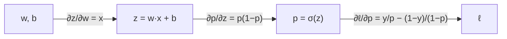
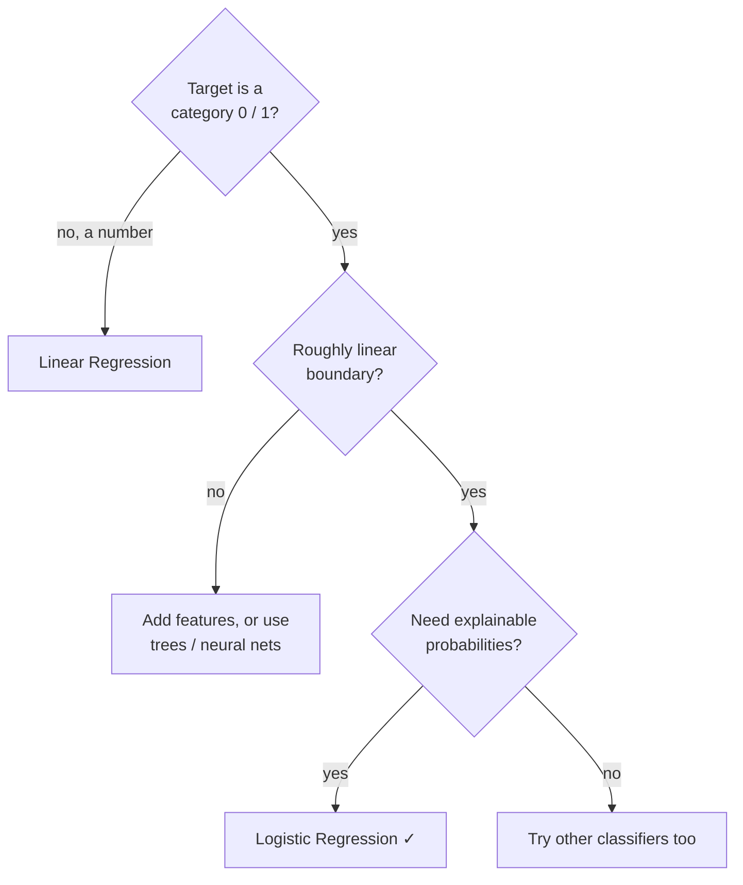

# Logistic Regression

> [!abstract] In one sentence
> Compute a linear score $z = w x + b$, squash it into a probability with the **sigmoid** $p = \sigma(z)$, score the parameters with the **likelihood** (the probability the model gave to what really happened), and use the **gradient** $(y - p)\,x$ to climb until the fit stops improving.

![[lg-01-linear-vs-logistic.png]]

**Contents**
1. [[#1. Why we need it]]
2. [[#2. Real-life example]]
3. [[#3. Explanation step by step]]
4. [[#4. Many features (vector form)]]
5. [[#5. How good is the model? (evaluation)]]
6. [[#6. Assumptions, limits and fixes]]
7. [[#7. Code]]
8. [[#8. Common mistakes]]
9. [[#9. Summary and cheat sheet]]
10. [[#10. Exercises]]

---

## 1. Why we need it

Many real questions have a **yes/no answer**, not a number:
- Is this email spam or not?
- Will this customer leave or stay?
- Is this tumor benign or malignant?
- Will this student pass or fail?

[[Linear Regression]] predicts a number, and using it on a 0/1 target fails in three ways:

| Problem | What happens |
|---|---|
| Invalid outputs | The line gives values like $-0.25$ or $1.08$, which are not probabilities |
| Bad shape | A straight line fits a step-shaped pattern badly |
| Outliers | One far-away point tilts the line and moves the decision point |

We want a model whose output is **always between 0 and 1** and rises smoothly from "very unlikely" to "very likely". That is logistic regression. Despite the name, it is a **classification** algorithm.

> [!info] Type of problem
> **Supervised learning → classification.** We have inputs $x$ and a known label $y \in \{0, 1\}$ for past examples. We want the **probability** that a new example has $y = 1$, and then a yes/no decision.

---

## 2. Real-life example

**Problem:** predict whether a student passes, from study hours. Data from 8 past students:

| Study hours $x$ | 1 | 2 | 3 | 4 | 5 | 6 | 7 | 8 |
|---|---|---|---|---|---|---|---|---|
| Result $y$ (1 = pass) | 0 | 0 | 0 | 1 | 0 | 1 | 1 | 1 |

The data is deliberately messy: one student studied 5 hours and still failed. Real data always looks like this, which is why we predict a **probability** and not a hard answer.

**Question:** a new student studies **6 hours**. How likely is a pass?
**Answer at the end:** about 84%, so predict "pass".

> [!example] Same idea elsewhere
> A bank predicts loan default from income and debt. The model says "7% chance of default". The bank then chooses its own threshold (for example, refuse above 20%) depending on how costly a mistake is.

---

## 3. Explanation step by step

### Overview of the training loop

```mermaid
flowchart TD
    A([Start: pick any w and b<br/>e.g. w = 0.3, b = -1]) --> B[Score<br/>zᵢ = w·xᵢ + b]
    B --> C[Probability<br/>pᵢ = σ(zᵢ)]
    C --> D[Log-likelihood ℓ<br/>how plausible is the data?]
    D --> E[Gradients<br/>mean of (p − y)·x and (p − y)]
    E --> F[Update<br/>w ← w − α·∂J/∂w<br/>b ← b − α·∂J/∂b]
    F --> G{Has ℓ stopped<br/>rising?}
    G -- no --> B
    G -- yes --> H([Done: predict new data<br/>with p = σ(w·x + b)])
```

### Notation

| Symbol | Meaning | In our example |
|---|---|---|
| $n$ | number of data points | 8 students |
| $x_i$, $y_i$ | input and true label of point $i$ | hours, pass = 1 / fail = 0 |
| $w$, $b$ | weight and bias (CS229 bundles them as $\theta$) | learned |
| $z_i$ | linear score $w x_i + b$ | any real number |
| $p_i = \sigma(z_i)$ | predicted probability of $y = 1$ (CS229 writes $h_\theta(x)$) | between 0 and 1 |
| $L$, $\ell$ | likelihood and log-likelihood | how plausible the data is |
| $J$ | loss $= -\ell / n$ (log loss) | what we minimize |
| $\alpha$ | learning rate | step size, e.g. 0.1 |

> [!note] Notation in other sources
> Andrew Ng's CS229 notes use $m$ for the number of examples, $\theta$ for all parameters, and $h_\theta(x)$ for the predicted probability. It is the same model, only renamed.

---

### Step 1 — The linear score

$$z = w\,x + b$$

This is the same line as in linear regression. $w$ says how much one extra hour matters, and $b$ shifts the curve left or right. The problem: $z$ can be any number from $-\infty$ to $+\infty$, and a probability must be in $[0, 1]$. We need a bridge.

---

### Step 2 — Squash $z$ into a probability: the sigmoid

$$p = \sigma(z) = \frac{1}{1 + e^{-z}}$$

Build it in three moves:
1. $e^{-z}$ is always positive. It is tiny for large positive $z$ and huge for very negative $z$.
2. $1 + e^{-z}$ is always above 1.
3. $\dfrac{1}{1 + e^{-z}}$ flips that range into $(0, 1)$.

| $z$ | $e^{-z}$ | $1 + e^{-z}$ | $p = \sigma(z)$ |
|---|---|---|---|
| -6 | 403.4 | 404.4 | 0.0025 |
| -2 | 7.389 | 8.389 | 0.119 |
| 0 | 1 | 2 | 0.500 |
| 2 | 0.135 | 1.135 | 0.881 |
| 6 | 0.0025 | 1.0025 | 0.9975 |

![[lg-02-sigmoid.png]]

**Properties worth remembering**
- The output is always strictly between 0 and 1.
- $\sigma(0) = 0.5$, which means "no idea".
- Symmetry: $\sigma(-z) = 1 - \sigma(z)$.
- Slope: $\sigma'(z) = \sigma(z)\,(1 - \sigma(z))$, with maximum $0.25$ at $z = 0$ and nearly $0$ for large $|z|$ (saturation).

> [!note]- Where the sigmoid comes from (click to expand): log-odds
> Probability $p$ → **odds** $\dfrac{p}{1-p}$ (range $0$ to $\infty$) → **log-odds** $\ln\dfrac{p}{1-p}$ (range $-\infty$ to $\infty$).
> Logistic regression assumes the log-odds are a straight line: $\ln\dfrac{p}{1-p} = z = wx + b$. Solving for $p$:
> $\dfrac{p}{1-p} = e^{z}$ → $p = e^{z}(1-p)$ → $p(1 + e^{z}) = e^{z}$ → $p = \dfrac{e^{z}}{1+e^{z}} = \dfrac{1}{1 + e^{-z}}$.
> So the sigmoid is the inverse of the log-odds ("logit") function. It also gives the meaning of $w$: each extra hour multiplies the **odds** of passing by $e^{w}$.

---

### Step 3 — Decide, and where the boundary is

$$\hat{y} = \begin{cases} 1 & \text{if } p \ge 0.5 \\ 0 & \text{otherwise} \end{cases}$$

$p = 0.5$ exactly when $z = 0$, so the **decision boundary** is at $x = -b / w$. The threshold 0.5 is a default and can be changed (see [[#5. How good is the model? (evaluation)]]).

---

### Step 4 — The probability of one student: the exponent trick

The model says $p$ = chance of passing. The student either passed or failed. The probability the model gave to **what really happened** is

$$P(y \mid x) = p^{\,y}\,(1 - p)^{\,1 - y}$$

- If $y = 1$ (passed): $p^1 (1-p)^0 = p$.
- If $y = 0$ (failed): $p^0 (1-p)^1 = 1 - p$.

The exponents are a compact if/else. Example with $w = 1,\ b = -4.5$:
- Student 4 studied 4 h and passed: $z = -0.5$, $p = \sigma(-0.5) = 1/(1 + e^{0.5}) = 0.378$, so the factor is $0.378$.
- Student 5 studied 5 h and failed: $p = 0.622$, so the factor is $1 - 0.622 = 0.378$.

---

### Step 5 — The likelihood: multiply all students

If the students are independent, the probability of the whole data set is the product:

$$L = \prod_{i=1}^{n} p_i^{\,y_i}\,(1 - p_i)^{\,1 - y_i}$$

$L$ answers: **"how likely is it that this model would produce exactly this data?"** The best $w, b$ make $L$ as large as possible. This is called **maximum likelihood estimation**.

![[lg-03-likelihood-product.png]]

With $w = 1,\ b = -4.5$ the eight factors are $0.971, 0.924, 0.818, 0.378, 0.378, 0.818, 0.924, 0.971$ and $L \approx 0.0767$. Every extra student multiplies in another number below 1, so with thousands of students the product underflows to 0. That is why we take the log.

> [!example] Coin analogy
> You flip a coin 3 times and see H, H, T. If heads has probability $\theta$, then $L(\theta) = \theta \cdot \theta \cdot (1-\theta)$. It is largest at $\theta = 2/3$, matching 2 heads out of 3. Logistic regression does the same, except each student has their own probability.

---

### Step 6 — The log-likelihood and the loss

Take $\ln$ of $L$ using three rules: the log of a product is a sum of logs, $\ln(ab) = \ln a + \ln b$, and an exponent comes down in front, $\ln(a^k) = k \ln a$:

$$\ell = \ln L = \sum_{i=1}^{n}\Big[\,y_i \ln p_i + (1 - y_i)\ln(1 - p_i)\,\Big]$$

For each student only one half is active, so $\ell$ is the sum of $\ln(\text{factor})$.

![[lg-04-log-likelihood.png]]

- $\ell = -2.568$ for $w = 1,\ b = -4.5$, and $e^{-2.568} = 0.0767$ is the same $L$.
- $\ln$ only increases, so the $w, b$ that maximize $\ell$ also maximize $L$.
- Computers minimize, so we flip the sign and average. This is the **log loss** (binary cross-entropy):

$$J = -\frac{\ell}{n} = -\frac{1}{n}\sum_{i=1}^{n}\Big[\,y_i \ln p_i + (1 - y_i)\ln(1 - p_i)\,\Big]$$

Here $J = 2.568 / 8 = 0.321$. Confident wrong answers are punished heavily: if $y = 1$ and $p = 0.95$ the term costs $0.05$, but if $p = 0.05$ it costs $3.0$.

> [!note]- Why not use squared error here? (click to expand)
> Squared error combined with the sigmoid gives a bumpy loss with several dips, so gradient descent can get stuck. The log loss is **convex** in $w$ and $b$: one bowl, one global minimum.

---

### Step 7 — The gradient: which way to move $w$ and $b$?

We need the slope $\partial \ell / \partial w$: *if I nudge $w$ up a tiny bit, how much does $\ell$ change?* The weight reaches $\ell$ through a chain, so we multiply the slope of each link (the **chain rule**):



For one student:

$$\frac{\partial \ell_i}{\partial w} = \underbrace{\left(\frac{y}{p} - \frac{1-y}{1-p}\right)}_{\text{link 3}} \cdot \underbrace{p(1-p)}_{\text{link 2}} \cdot \underbrace{x}_{\text{link 1}}$$

The $p$ in $1/p$ cancels against the $p$ in $p(1-p)$ (and $1-p$ cancels in the other case):
- $y = 1$: $\dfrac{1}{p}\cdot p(1-p)\cdot x = (1 - p)\,x$
- $y = 0$: $-\dfrac{1}{1-p}\cdot p(1-p)\cdot x = -p\,x$
- Both cases in one formula: $(y - p)\,x$.

$$\boxed{\frac{\partial \ell}{\partial w} = \sum_i (y_i - p_i)\,x_i \qquad \frac{\partial \ell}{\partial b} = \sum_i (y_i - p_i)}$$

The ugly sigmoid and log terms cancel and leave **error × input**. For $b$ the input is replaced by 1, because $\partial z / \partial b = 1$.

![[lg-05-gradient-one-student.png]]

Check with $w = 1,\ b = -4.5$:
- Student 4 (4 h, passed, $p = 0.378$): $(1 - 0.378)\cdot 4 = +2.49$ → raise $w$.
- Student 5 (5 h, failed, $p = 0.622$): $(0 - 0.622)\cdot 5 = -3.11$ → lower $w$.

Because we minimize $J = -\ell/n$, all signs flip and we average:

$$\frac{\partial J}{\partial w} = \frac{1}{n}\sum_i (p_i - y_i)\,x_i \qquad \frac{\partial J}{\partial b} = \frac{1}{n}\sum_i (p_i - y_i)$$

> [!tip] Same shape as linear regression
> Compare with [[Linear Regression]]: there the gradient was error × input too. The sigmoid only changes what "prediction" means.

---

### Step 8 — Gradient descent (the update rule)

$$w \leftarrow w - \alpha\,\frac{\partial J}{\partial w}, \qquad b \leftarrow b - \alpha\,\frac{\partial J}{\partial b}$$

(Equivalent view: gradient **ascent** on $\ell$, which has a plus sign.)

#### One step by hand

Start at $w = 0.3,\ b = -1$, with $\alpha = 0.1$:

| Hours $x$ | $y$ | $p$ | error $p - y$ | $(p - y)\,x$ |
|---|---|---|---|---|
| 1 | 0 | 0.332 | +0.332 | +0.332 |
| 2 | 0 | 0.401 | +0.401 | +0.803 |
| 3 | 0 | 0.475 | +0.475 | +1.425 |
| 4 | 1 | 0.550 | -0.450 | -1.801 |
| 5 | 0 | 0.622 | +0.622 | +3.112 |
| 6 | 1 | 0.690 | -0.310 | -1.860 |
| 7 | 1 | 0.750 | -0.250 | -1.748 |
| 8 | 1 | 0.802 | -0.198 | -1.583 |

![[lg-06-gradient-bars.png]]

- $\partial J / \partial w = -1.320 / 8 = -0.165$ and $\partial J / \partial b = 0.622 / 8 = 0.078$.
- $w \leftarrow 0.3 - 0.1 \cdot (-0.165) = 0.3165$ and $b \leftarrow -1 - 0.1 \cdot 0.078 = -1.0078$.

One step is small. Repeat it 1000 times.

#### Result after 1000 steps

![[lg-07-training.png]]

| | Value |
|---|---|
| $w$ | 1.018 |
| $b$ | -4.478 |
| $\ell$ | -2.5645 (best possible for this data) |
| decision boundary $-b/w$ | 4.40 hours |

#### Answer to the real-life question

A student who studies 6 hours: $z = 1.018 \cdot 6 - 4.478 = 1.63$, so $p = \sigma(1.63) = 0.84$. **84% chance of passing → predict pass.**

> [!info] Why $\ell$ cannot reach 0
> Student 4 (4 h) passed and student 5 (5 h) failed, so no single S-curve fits everyone perfectly. The final $w$ is a compromise: raising $w$ helps student 4 but hurts student 5.

---

## 4. Many features (vector form)

With several inputs (hours, sleep, past grades):

$$z = w_1 x_1 + w_2 x_2 + \dots + w_d x_d + b = \mathbf{w}^\top \mathbf{x} + b, \qquad p = \sigma(z)$$

The gradient keeps the same shape: $\nabla_{\mathbf{w}} J = \frac{1}{n} X^\top (\mathbf{p} - \mathbf{y})$. Each weight is interpreted as a **log-odds** change: $e^{w_j}$ is the factor by which the odds of $y = 1$ multiply when $x_j$ rises by 1, other features fixed.

For **more than two classes** replace the sigmoid with the **softmax**, which gives one probability per class that sum to 1. It is the same idea used in the last layer of a neural network.

---

## 5. How good is the model? (evaluation)

Accuracy alone can mislead, especially with imbalanced classes. Use the **confusion matrix**.

On our training data at threshold 0.5:

| | Predicted fail | Predicted pass |
|---|---|---|
| **Actually failed** | 3 (TN) | 1 (FP: student 5) |
| **Actually passed** | 1 (FN: student 4) | 3 (TP) |

| Metric | Formula | Value |
|---|---|---|
| Accuracy | $(TP + TN)/n$ | 0.75 |
| Precision | $TP / (TP + FP)$ | 0.75 |
| Recall | $TP / (TP + FN)$ | 0.75 |
| F1 | harmonic mean of precision and recall | 0.75 |

**Choosing the threshold**
- Cancer screening: missing a real case is worse than a false alarm → lower threshold, e.g. $p \ge 0.2$.
- Spam filter: hiding a real email is worse → higher threshold, e.g. $p \ge 0.9$.
- Plot precision/recall or the ROC curve over all thresholds to choose.

> [!warning] Small data
> These numbers use only 8 training points, so they only illustrate the formulas. Always evaluate on held-out data (`train_test_split`) or with cross-validation.

---

## 6. Assumptions, limits and fixes

### Assumptions
- Examples are **independent**.
- The **log-odds are linear** in the features.
- Features are not strongly correlated with each other.

### Limit 1 — Linear boundary only
The boundary $w \cdot x + b = 0$ is a straight line (a flat plane in higher dimensions). Patterns like XOR cannot be separated. **Fix:** add features ($x^2$, interactions), or use trees or a neural network.

### Limit 2 — Perfectly separable data
If a line splits the classes perfectly, $\ell$ keeps rising as the weights grow without limit. **Fix:** regularization (L2 or L1), which penalizes large weights.

### Limit 3 — Imbalanced classes
With 99% "no" labels, always predicting "no" scores 99% accuracy. **Fix:** class weights, resampling, and precision/recall instead of accuracy.

### Limit 4 — Unscaled features
Gradient descent converges slowly when features have very different ranges. **Fix:** standardize the inputs.

### When to use it



---

## 7. Code

### 7a. From scratch — NumPy

```python
import numpy as np

x = np.array([1, 2, 3, 4, 5, 6, 7, 8], dtype=float)
y = np.array([0, 0, 0, 1, 0, 1, 1, 1], dtype=float)

w, b = 0.3, -1.0     # start anywhere
alpha = 0.1          # learning rate
n = len(x)

def sigmoid(z):
    return 1 / (1 + np.exp(-z))

for step in range(1000):
    p = sigmoid(w * x + b)                 # Steps 1-2: score -> probability
    error = p - y                          # Step 7: error
    dw = np.mean(error * x)                # ∂J/∂w
    db = np.mean(error)                    # ∂J/∂b
    w -= alpha * dw                        # Step 8: update
    b -= alpha * db

p = sigmoid(w * x + b)
factors = np.where(y == 1, p, 1 - p)       # Step 4: exponent trick
loglik = np.sum(np.log(factors))           # Step 6: ℓ

print(w, b)                                # 1.018  -4.478
print(loglik)                              # -2.5645
print(sigmoid(w * 6 + b))                  # 0.836  (6 hours)
```

### 7b. scikit-learn (what you use in practice)

```python
from sklearn.linear_model import LogisticRegression
from sklearn.model_selection import train_test_split
from sklearn.metrics import confusion_matrix, classification_report

X = x.reshape(-1, 1)                       # sklearn wants 2-D input
model = LogisticRegression(penalty=None).fit(X, y)   # no regularization, like our version
print(model.coef_, model.intercept_)       # w, b
print(model.predict_proba([[6]]))          # [P(fail), P(pass)]
print(model.predict([[6]]))                # final class at threshold 0.5
```

> [!tip] Defaults
> `LogisticRegression()` applies L2 regularization with `C=1.0` by default, so its weights differ from the plain maximum-likelihood fit. Related: `LogisticRegressionCV`, `SGDClassifier(loss="log_loss")`, `class_weight="balanced"`.

---

## 8. Common mistakes

> [!bug] Watch out for these
> - **Using squared error** with the sigmoid. Use the log loss.
> - **Mixing up the signs:** $\ell$ is maximized (plus sign), $J = -\ell/n$ is minimized (minus sign). The gradient of $J$ uses $(p - y)$; the gradient of $\ell$ uses $(y - p)$.
> - **$\ln(0)$:** if $p$ reaches exactly 0 or 1 the log blows up. Clip $p$ to $[10^{-12},\ 1 - 10^{-12}]$.
> - **Treating $p$ as certainty.** 0.84 means "84% likely", not "will pass".
> - **Always using 0.5** as the threshold.
> - **Not scaling features** before gradient descent or regularization.
> - **Judging by accuracy** on imbalanced classes.
> - **Evaluating only on training data.**
> - **Thinking "regression" means it predicts numbers.** It models a probability and is used for classification.

---

## 9. Summary and cheat sheet

| Item | Formula |
|---|---|
| Score | $z = w x + b$ (vector: $\mathbf{w}^\top \mathbf{x} + b$) |
| Sigmoid | $p = \sigma(z) = \dfrac{1}{1 + e^{-z}}$ |
| Sigmoid slope | $\sigma'(z) = \sigma(z)(1 - \sigma(z))$ |
| Decision | predict 1 if $p \ge 0.5$; boundary at $x = -b/w$ |
| One example | $P(y \mid x) = p^{y}(1-p)^{1-y}$ |
| Likelihood | $L = \prod_i p_i^{y_i}(1 - p_i)^{1 - y_i}$ |
| Log-likelihood | $\ell = \sum_i [\,y_i \ln p_i + (1 - y_i)\ln(1 - p_i)\,]$ |
| Loss (log loss) | $J = -\ell / n$ |
| Gradient | $\dfrac{\partial J}{\partial w} = \dfrac{1}{n}\sum (p_i - y_i)\,x_i$, $\dfrac{\partial J}{\partial b} = \dfrac{1}{n}\sum (p_i - y_i)$ |
| Update | $w \leftarrow w - \alpha\,\partial J/\partial w$, $b \leftarrow b - \alpha\,\partial J/\partial b$ |
| Meaning of $w$ | $e^{w}$ = odds multiplier per +1 in $x$ |

**Key ideas to remember**
1. Logistic regression predicts a **probability** by squashing a linear score through the sigmoid.
2. Training = **maximum likelihood**: pick $w, b$ so the data is as plausible as possible.
3. The log turns the product into a sum; $J = -\ell/n$ is the **log loss**.
4. The gradient simplifies to **error × input**, the same shape as in [[Linear Regression]].
5. The loss is **convex**, so gradient descent finds the single best answer.
6. The threshold is a **business choice**, not always 0.5.

> [!quote] Sources for the derivation
> The likelihood and log-likelihood formulas follow the standard treatment in:
> - Andrew Ng, [CS229 classification notes (copy)](https://kellog-test.readthedocs.io/en/latest/week_7/classification/ng-classification-notes.pdf)
> - Chris Piech, [CS109 Logistic Regression notes](https://web.stanford.edu/class/archive/cs/cs109/cs109.1196/lectureNotes/25%20-%20LogisticRegression.pdf)
>
> The 8-student example and all numbers in this note are my own illustration, computed with the code in section 7.

---

## 10. Exercises

- [ ] Compute $\sigma(1)$ and $\sigma(-1)$ by hand and check that they add up to 1.
- [ ] Change student 5's result from fail to pass. Predict what happens to $w$, then run the code.
- [ ] Do a second gradient-descent step by hand, starting from $w = 0.3165,\ b = -1.0078$.
- [ ] Run the code with $\alpha = 1.0$ and then $\alpha = 0.001$. What happens to $\ell$?
- [ ] Make the data perfectly separable (e.g. fails at 1 to 4 h, passes at 5 to 8 h) and watch $w$ grow. Then fit `LogisticRegression()` with its default L2 penalty.
- [ ] Compute the confusion matrix at thresholds 0.3 and 0.7. Which students change class?
- [ ] Add a second feature (hours slept) and use the vector form.

---

**Previous algorithm:** [[Linear Regression]]
