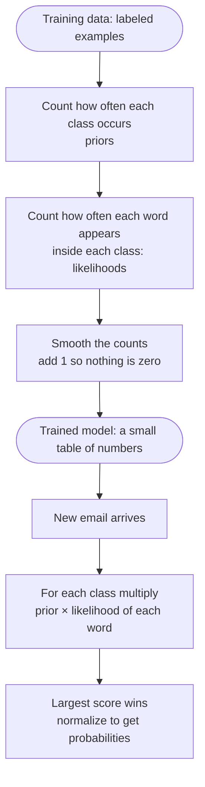
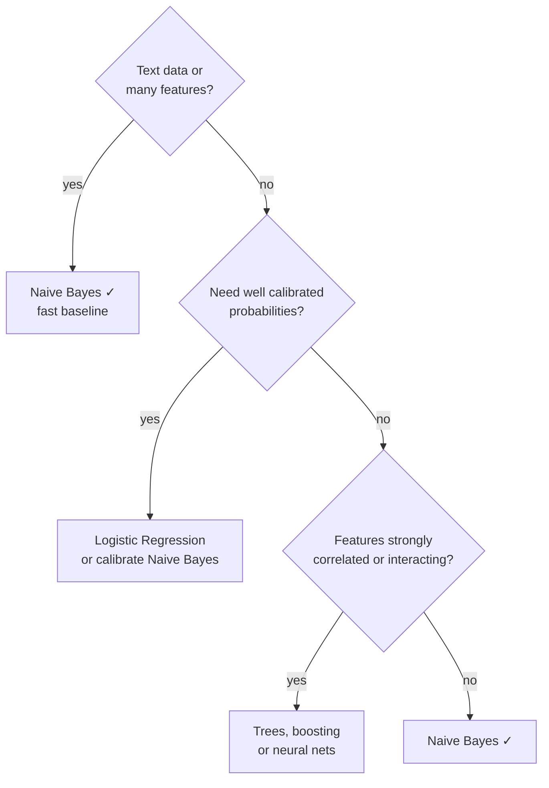

# Naive Bayes

> [!abstract] In one sentence
> To classify a new example, ask for each class "how common is this class, and how likely are these features inside it?", multiply those numbers (this is **Bayes' theorem** plus the **naive** assumption that features are independent given the class), and pick the class with the largest result. Training is only **counting**.

![[nb-01-prior-and-likelihood.png]]

**Contents**
1. [[#1. Why we need it]]
2. [[#2. Real-life example]]
3. [[#3. Explanation step by step]]
4. [[#4. Many features (vector form)]]
5. [[#5. How good is the model? (evaluation)]]
6. [[#6. Assumptions, limits and fixes]]
7. [[#7. Code]]
8. [[#8. Common mistakes]]
9. [[#9. Summary and cheat sheet]]
10. [[#10. Exercises]]

---

## 1. Why we need it

Many classification problems have **thousands of features**:
- Is this email spam? Every word of the email is a feature.
- Which topic is this news article about? Again, every word.
- Which language is this sentence written in?

The two classifiers we already know struggle here:

| Algorithm | Problem with huge, sparse features |
|---|---|
| [[Logistic Regression]] | Needs many gradient-descent passes, and needs enough data to fit one weight per feature |
| [[K-Nearest Neighbors]] | Must store every example and measure the distance to all of them for each prediction. Distances become meaningless in thousands of dimensions |

Naive Bayes takes a different route: it **counts**. One pass over the data gives a table of probabilities, and a prediction is a handful of multiplications. That makes it:
- **very fast** to train and to predict,
- good with **small datasets** and with **many features**,
- naturally **multi-class** (spam / promotions / personal, no extra work),
- a strong first **baseline** for text.

> [!info] Type of problem
> **Supervised learning → classification.** We have examples with known labels. We want the **probability of each class** for a new example, and then a decision. It is a **generative** model: it learns "what does a spam email look like?" and "what does a normal email look like?", then asks which description fits the new email better.

---

## 2. Real-life example

**Problem:** decide whether an email is spam from the words it contains. To keep the numbers small we look at only three words. Data from 10 past emails, already labeled:

| # | Words in the email (of the three) | Label |
|---|---|---|
| 1 | free, winner | spam |
| 2 | free, winner | spam |
| 3 | free | spam |
| 4 | none of the three | spam |
| 5 | meeting | normal |
| 6 | meeting | normal |
| 7 | free, meeting | normal |
| 8 | meeting | normal |
| 9 | none of the three | normal |
| 10 | none of the three | normal |

Counting gives the table we will use all the way through:

| | Emails | contain "free" | contain "winner" | contain "meeting" |
|---|---|---|---|---|
| **Spam** | 4 | 3 | 2 | 0 |
| **Normal** | 6 | 1 | 0 | 4 |

**Question:** a new email contains **"free"**, **"winner"** and **"meeting"**. Is it spam?
**Answer at the end:** about 65.5% spam, so predict spam (a mild lean, not a certainty).

> [!example] Same idea elsewhere
> A news site sorts articles into sports, politics and business from their words. A hospital model estimates "benign or malignant" from measurements such as cell size. A messaging app guesses the language of a sentence from its letter pairs. In each case the model multiplies many small pieces of evidence.

> [!note] Why only three words?
> A real spam filter looks at thousands of words. We keep three so every calculation can be done by hand. The method is identical.

---

## 3. Explanation step by step

### Overview



### Notation

| Symbol | Meaning | In our example |
|---|---|---|
| $\mathbf{x} = (x_1, \dots, x_n)$ | the features of one example | which of the 3 words are in the email |
| $c$ | a class | spam or normal |
| $N$, $N_c$ | number of training examples, and how many are in class $c$ | $N = 10$, $N_{\text{spam}} = 4$, $N_{\text{normal}} = 6$ |
| $N_{c,i}$ | examples of class $c$ that contain word $i$ | e.g. "free" in spam: 3 |
| $P(c)$ | **prior**: how common the class is | 0.4 for spam |
| $P(x_i \mid c)$ | **likelihood**: how often feature $i$ appears in class $c$ | "free" given spam |
| $P(c \mid \mathbf{x})$ | **posterior**: probability of the class after seeing the features | what we want |
| $\alpha$ | smoothing constant | 1 |

---

### Step 1 — Bayes' theorem

Start from the definition of conditional probability. The joint probability of $A$ and $B$ can be written in two ways:

$$P(A \cap B) = P(A \mid B)\,P(B) = P(B \mid A)\,P(A)$$

Divide by $P(B)$:

$$\boxed{P(A \mid B) = \frac{P(B \mid A)\,P(A)}{P(B)}}$$

It lets us **flip** a conditional probability. We can easily count "how often is the word *free* in spam?" ($P(\text{word} \mid \text{spam})$), but what we want is the reverse: "given these words, how likely is spam?" ($P(\text{spam} \mid \text{words})$).

---

### Step 2 — Apply it to classification

Set $A$ = "the class is $c$" and $B$ = "the features are $\mathbf{x}$":

$$P(c \mid \mathbf{x}) = \frac{P(\mathbf{x} \mid c)\;P(c)}{P(\mathbf{x})}$$

| Part | Name | Meaning |
|---|---|---|
| $P(c \mid \mathbf{x})$ | posterior | the answer we want |
| $P(c)$ | prior | how common the class is before we look at the email |
| $P(\mathbf{x} \mid c)$ | likelihood | how likely this exact set of words is inside class $c$ |
| $P(\mathbf{x})$ | evidence | how likely this set of words is overall |

The prior is easy: it is a count. The hard part is the likelihood.

---

### Step 3 — The problem: the joint likelihood is too expensive

$P(\text{free, winner, meeting} \mid \text{spam})$ means "among spam emails, how many contain **this exact combination** of words?" With $n$ yes/no words there are $2^n$ combinations, so we would need $2^n - 1$ numbers per class, and enough emails to see every combination.

- 3 words: 7 numbers per class. Fine.
- 30 words: more than a billion.
- 10,000 words: impossible.

Even in our tiny dataset the exact combination (free, winner, meeting) **never appears**. Counting it gives $0/4$ for spam and $0/6$ for normal, which tells us nothing. We need a shortcut.

---

### Step 4 — The "naive" assumption

The chain rule of probability is always true:

$$P(\text{free}, \text{winner}, \text{meeting} \mid c) = P(\text{free} \mid c)\; P(\text{winner} \mid \text{free}, c)\; P(\text{meeting} \mid \text{free}, \text{winner}, c)$$

Now **assume** that, once we know the class, each word does not depend on the other words. Then the conditions drop out:

$$\boxed{P(\mathbf{x} \mid c) = \prod_{i=1}^{n} P(x_i \mid c)}$$

Each factor is a simple count again. We now need only **$n$ numbers per class** instead of $2^n - 1$.

> [!warning] Why it is called "naive"
> The assumption is usually false. In real emails "free" and "winner" often appear together. We pretend they do not. The model still classifies well in practice, but its probabilities are less trustworthy (section 6).

Putting it together:

$$P(c \mid \mathbf{x}) = \frac{P(c)\prod_{i=1}^{n} P(x_i \mid c)}{P(\mathbf{x})}$$

---

### Step 5 — Drop the evidence and decide

$P(\mathbf{x})$ is the same for every class, so it cannot change which class is larger. Drop it and compare **scores**:

$$\text{score}(c) = P(c)\prod_{i} P(x_i \mid c), \qquad \hat{y} = \arg\max_c \;\text{score}(c)$$

This is the **Maximum A Posteriori (MAP)** rule: choose the class with the highest posterior.

---

### Step 6 — Training, part 1: the priors

Count the classes:

$$\hat{P}(c) = \frac{N_c}{N} \qquad\Rightarrow\qquad P(\text{spam}) = \frac{4}{10} = 0.4, \quad P(\text{normal}) = \frac{6}{10} = 0.6$$

> [!note] Why counting is the best estimate
> Let $\pi$ be the unknown probability of spam. The probability of our labels is $\pi^{N_1}(1-\pi)^{N_0}$, so the log-likelihood is $\ell(\pi) = N_1 \ln \pi + N_0 \ln(1-\pi)$. Setting the derivative to zero, $\dfrac{N_1}{\pi} - \dfrac{N_0}{1-\pi} = 0$, gives $\pi = \dfrac{N_1}{N_1 + N_0}$: the fraction of spam. This is **maximum likelihood estimation**, and it turns out to be plain counting.

---

### Step 7 — Training, part 2: the likelihoods, and a problem

For each class and word, count the fraction of emails in that class that contain the word:

$$\hat{P}(x_i \mid c) = \frac{N_{c,i}}{N_c}$$

| | free | winner | meeting |
|---|---|---|---|
| **Spam** | 3/4 | 2/4 | **0/4** |
| **Normal** | 1/6 | **0/6** | 4/6 |

Try the scores for the new email (free, winner, meeting):

$$\text{spam: } 0.4 \times \tfrac{3}{4} \times \tfrac{2}{4} \times \tfrac{0}{4} = 0 \qquad \text{normal: } 0.6 \times \tfrac{1}{6} \times \tfrac{0}{6} \times \tfrac{4}{6} = 0$$

Both scores are **0**, so we cannot decide. One word that was never seen in a class ("meeting" in spam, "winner" in normal) wipes out the whole product, however strong the other evidence is. This is the **zero-frequency problem**.

![[nb-03-smoothing.png]]

---

### Step 8 — Laplace smoothing

Pretend we saw every outcome **$\alpha$ extra times**. With $\alpha = 1$ (Laplace smoothing) and yes/no features:

$$\hat{P}(x_i = 1 \mid c) = \frac{N_{c,i} + \alpha}{N_c + 2\alpha}$$

The $2\alpha$ in the denominator is there because a word has **two** outcomes (present or absent) and each gets $\alpha$ extra counts, so "present" and "absent" still add up to 1.

Spam has $N_c = 4$, so the denominator is $4 + 2 = 6$. Normal has $N_c = 6$, so it is $6 + 2 = 8$:

| | free | winner | meeting |
|---|---|---|---|
| **Spam** | $\frac{3+1}{6} = 0.667$ | $\frac{2+1}{6} = 0.5$ | $\frac{0+1}{6} = 0.167$ |
| **Normal** | $\frac{1+1}{8} = 0.25$ | $\frac{0+1}{8} = 0.125$ | $\frac{4+1}{8} = 0.625$ |

No zeros remain. The numbers that were already well supported barely moved; only the zero cells were lifted.

---

### Step 9 — Score each class for the new email

$$\text{spam: } 0.4 \times 0.667 \times 0.5 \times 0.167 = 0.0222$$

$$\text{normal: } 0.6 \times 0.25 \times 0.125 \times 0.625 = 0.0117$$

Spam has the larger score, so the **prediction is spam**.

---

### Step 10 — Normalize to probabilities

The scores are not probabilities yet. Divide each by their sum ($0.0222 + 0.0117 = 0.0339$), which is exactly the evidence $P(\mathbf{x})$ we dropped in Step 5:

$$P(\text{spam} \mid \mathbf{x}) = \frac{0.0222}{0.0339} \approx 0.655 \qquad P(\text{normal} \mid \mathbf{x}) = \frac{0.0117}{0.0339} \approx 0.345$$

---

### Step 11 — Use logarithms

With thousands of words, a product of tiny numbers underflows to 0 on a computer. Since $\log$ is increasing it does not change which class wins, and it turns the product into a **sum**:

$$\log \text{score}(c) = \log P(c) + \sum_{i} \log P(x_i \mid c)$$

For our email:

$$\text{spam: } \ln 0.4 + \ln 0.667 + \ln 0.5 + \ln 0.167 = -0.916 - 0.405 - 0.693 - 1.792 = -3.807$$

$$\text{normal: } \ln 0.6 + \ln 0.25 + \ln 0.125 + \ln 0.625 = -0.511 - 1.386 - 2.079 - 0.470 = -4.447$$

The difference is $-3.807 - (-4.447) = 0.640$, the **log-odds** of spam. Convert back with the sigmoid: $\dfrac{1}{1 + e^{-0.64}} = 0.655$. The same answer.

![[nb-02-scores-and-log-odds.png]]

Each word adds a fixed amount to the log-odds: "free" pushes toward spam (+0.98), "winner" pushes strongly toward spam (+1.39), "meeting" pushes back toward normal (−1.32), and the prior leans slightly toward normal (−0.41).

#### Answer to the real-life question

The email with "free", "winner" and "meeting" has a **65.5% chance of being spam → predict spam.** The word "meeting" pulls the result back toward normal, so the lean is only moderate.

#### The model scores every email separately

The trained table does not say "future mail is probably spam". Each new email gets its own calculation from its own words:

![[nb-04-different-emails.png]]

| Email contains | Spam score | Normal score | P(spam) |
|---|---|---|---|
| nothing we know | 0.4 | 0.6 | 40.0% (just the prior) |
| meeting | $0.4 \times 0.167 = 0.0667$ | $0.6 \times 0.625 = 0.375$ | 15.1% → normal |
| free, winner | $0.4 \times 0.667 \times 0.5 = 0.1333$ | $0.6 \times 0.25 \times 0.125 = 0.0188$ | 87.7% → spam |
| free, winner, meeting | 0.0222 | 0.0117 | 65.5% → spam |

> [!info] Which words count?
> In this hand calculation we multiply only the words that are **in** the email. A strict **Bernoulli** model also multiplies in $1 - P(\text{word} \mid c)$ for every word that is **absent**. For the email with all three words nothing is absent, so both give 65.5%. For the email containing only "meeting", Bernoulli gives 4.3% spam instead of 15.1% (both still say normal). Multinomial Naive Bayes, the usual choice for text, also uses only the words that appear. See section 4 and the code in section 7.

---

## 4. Many features (vector form)

With $n$ features the rule is the same as before:

$$\hat{y} = \arg\max_c \left[\log P(c) + \sum_{i=1}^{n} \log P(x_i \mid c)\right]$$

For **word counts** $\mathbf{x}$ (how many times each word appears) this is a dot product plus a constant:

$$\log \text{score}(c) = \log P(c) + \mathbf{x}^\top \log \boldsymbol{\theta}_c$$

where $\boldsymbol{\theta}_c$ holds the word probabilities of class $c$. So a trained Naive Bayes model is a **linear classifier** in disguise: each word has a weight, and the weights come from counting.

**More than two classes.** Compute a log-score for every class, take the largest, and turn the scores into probabilities with the softmax:

$$P(c \mid \mathbf{x}) = \frac{e^{s_c}}{\sum_{k} e^{s_k}}, \qquad s_c = \log \text{score}(c)$$

**Variants.** They differ only in how $P(x_i \mid c)$ is modeled.

| Variant | Feature type | $P(x_i \mid c)$ | Typical use |
|---|---|---|---|
| **Bernoulli** | yes/no (word present?) | $p_{c,i}^{\,x_i}(1 - p_{c,i})^{1 - x_i}$ with $p_{c,i} = \dfrac{N_{c,i} + \alpha}{N_c + 2\alpha}$ | short texts, binary features |
| **Multinomial** | counts (how often?) | $\theta_{c,i} = \dfrac{\text{count}(w_i, c) + \alpha}{\sum_j \text{count}(w_j, c) + \alpha\,\lvert V \rvert}$ | text, word counts or tf-idf |
| **Gaussian** | continuous numbers | $\dfrac{1}{\sqrt{2\pi\sigma_{c,i}^2}} \exp\!\Big(-\dfrac{(x_i - \mu_{c,i})^2}{2\sigma_{c,i}^2}\Big)$ | measurements (size, height, sensor values) |
| **Complement** | counts, imbalanced classes | uses the counts of all *other* classes | imbalanced text data |

For Gaussian Naive Bayes, "training" means computing the **mean $\mu_{c,i}$ and variance $\sigma_{c,i}^2$** of each feature inside each class. $\lvert V \rvert$ is the vocabulary size.

**Two classes: the log-odds are a sum.**

$$\log\frac{P(1 \mid \mathbf{x})}{P(0 \mid \mathbf{x})} = \log\frac{P(1)}{P(0)} + \sum_{i}\log\frac{P(x_i \mid 1)}{P(x_i \mid 0)}$$

This is exactly the staircase in the picture above. It has the same shape as [[Logistic Regression]] ($b + \sum w_i x_i$). The difference is how the weights are found:

| | Naive Bayes | [[Logistic Regression]] | [[K-Nearest Neighbors]] |
|---|---|---|---|
| Learns | how each class **generates** the features | the boundary between classes directly | nothing (stores the data) |
| Training | one pass of counting | gradient descent, many passes | none |
| Prediction | a few multiplications | one dot product and a sigmoid | distance to every stored example |
| Weights | computed independently per feature | fitted **jointly** | none |
| Probabilities | often overconfident | usually better calibrated | rough (the vote share) |

---

## 5. How good is the model? (evaluation)

The 10 emails only illustrate the formulas. For a real evaluation we need **held-out data**. Example: the Breast Cancer Wisconsin dataset that ships with scikit-learn (569 tumors, 30 measurements each, labeled malignant or benign). We keep 25% (143 tumors) as a test set and fit **Gaussian** Naive Bayes on the other 426 (code in section 7).

Taking "benign" as the positive class, the held-out results are:

| | Predicted malignant | Predicted benign |
|---|---|---|
| **Actually malignant** | 46 (TN) | 7 (FP) |
| **Actually benign** | 2 (FN) | 88 (TP) |

| Metric | Formula | Value |
|---|---|---|
| Accuracy | $(TP + TN)/n$ | 0.937 |
| Precision | $TP/(TP + FP)$ | 0.926 |
| Recall | $TP/(TP + FN)$ | 0.978 |
| F1 | harmonic mean of precision and recall | 0.951 |

Five-fold cross-validation on all 569 tumors gives a mean accuracy of **0.939**, in line with the single split.

**Which error matters?** Here the costly mistake is the 7 tumors that were **actually malignant but predicted benign**. Accuracy hides this. Because Naive Bayes outputs a probability, you can move the threshold, for example call a tumor benign only if $P(\text{benign}) \ge 0.95$, and check precision and recall again.

> [!warning] Do not trust the exact percentages
> On this test set, 94% of the predictions came with a probability above 0.99, yet 6% of the predictions were wrong. The independence assumption makes the model count related features as separate evidence, so it is **overconfident**. Use the probabilities to **rank** examples and to choose a class, and calibrate them (section 6) if you need real probabilities.

---

## 6. Assumptions, limits and fixes

### Assumptions
- Features are **conditionally independent given the class**.
- Each feature follows the chosen model: yes/no (Bernoulli), counts (Multinomial) or a bell curve (Gaussian).
- Training examples are independent, and the new data looks like the training data.

### Limit 1 — Correlated features are counted twice
If two features carry the same information, their evidence is multiplied twice. Add a second, identical copy of "free" to our email and the spam probability jumps from 65.5% to **83.5%**, although no new information arrived. **Fix:** remove duplicated or strongly correlated features, or use [[Logistic Regression]], which fits the weights together and shares the credit.

### Limit 2 — Zero frequencies
A feature value never seen in a class gives probability 0 and wipes out the product (Step 7). **Fix:** smoothing, $\alpha = 1$ or a smaller value. Choose $\alpha$ by cross-validation. Words that were never in the training vocabulary are simply ignored at prediction time.

### Limit 3 — Overconfident probabilities
The class is usually right, the percentage is not. **Fix:** calibrate on held-out data (`CalibratedClassifierCV`) when you need trustworthy probabilities.

### Limit 4 — Wrong distribution for the feature
Gaussian NB assumes a bell curve per class. Skewed features fit badly. **Fix:** transform the feature (for example take its log), or switch to a variant that matches the data (counts → Multinomial).

### Limit 5 — No feature interactions
The model cannot learn "this word matters only when that word is also present". **Fix:** add combined features, or use trees or a neural network.

### Limit 6 — Imbalanced classes
With 99% normal mail the prior alone pushes every email toward normal. **Fix:** set the priors by hand (`class_prior`, `fit_prior=False`), use Complement NB, and judge the model with precision and recall instead of accuracy.

### When to use it



---

## 7. Code

### 7a. From scratch — NumPy

```python
import numpy as np

words = ["free", "winner", "meeting"]
# one row per email, 1 = the word is in the email
X = np.array([[1, 1, 0],    # spam
              [1, 1, 0],    # spam
              [1, 0, 0],    # spam
              [0, 0, 0],    # spam
              [0, 0, 1],    # normal
              [0, 0, 1],    # normal
              [1, 0, 1],    # normal
              [0, 0, 1],    # normal
              [0, 0, 0],    # normal
              [0, 0, 0]])   # normal
y = np.array(["spam"] * 4 + ["normal"] * 6)
alpha = 1                                      # Laplace smoothing
classes = ["spam", "normal"]

# --- training = counting ---
prior = {c: np.mean(y == c) for c in classes}                         # Step 6
likelihood = {c: (X[y == c].sum(axis=0) + alpha) / ((y == c).sum() + 2 * alpha)
              for c in classes}                                       # Steps 7-8

# --- prediction ---
def predict(email_words):
    idx = [words.index(w) for w in email_words]
    score = {c: prior[c] * np.prod(likelihood[c][idx]) for c in classes}      # Step 9
    total = sum(score.values())
    return {c: round(float(s / total), 3) for c, s in score.items()}          # Step 10

def log_scores(email_words):                                                  # Step 11
    idx = [words.index(w) for w in email_words]
    return {c: round(float(np.log(prior[c]) + np.sum(np.log(likelihood[c][idx]))), 3)
            for c in classes}

print(predict(["free", "winner", "meeting"]))      # {'spam': 0.655, 'normal': 0.345}
print(predict(["meeting"]))                        # {'spam': 0.151, 'normal': 0.849}
print(log_scores(["free", "winner", "meeting"]))   # {'spam': -3.807, 'normal': -4.447}
```

### 7b. scikit-learn (what you use in practice)

**The same 10 emails with `BernoulliNB`** (it also counts absent words, see the callout in section 3):

```python
from sklearn.naive_bayes import BernoulliNB

model = BernoulliNB(alpha=1.0).fit(X, y)           # alpha=1 is Laplace smoothing
print(model.classes_)                              # ['normal' 'spam']
print(model.predict_proba([[1, 1, 1]]).round(3))   # [[0.345 0.655]]  -> 65.5% spam, as by hand
print(model.predict_proba([[0, 0, 1]]).round(3))   # [[0.957 0.043]]  -> only "meeting": 4.3% spam
```

**Text classification with `MultinomialNB`** (the usual choice for words):

```python
from sklearn.feature_extraction.text import CountVectorizer
from sklearn.naive_bayes import MultinomialNB
from sklearn.pipeline import make_pipeline

texts = ["free prize winner claim now", "win a free prize today", "free money winner",
         "limited offer free gift", "meeting at ten tomorrow", "project meeting notes attached",
         "lunch meeting with the team", "please review the report before the meeting"]
labels = ["spam"] * 4 + ["normal"] * 4

text_model = make_pipeline(CountVectorizer(), MultinomialNB(alpha=1.0)).fit(texts, labels)
new = "claim your free gift now"
print(text_model.predict([new]))                   # ['spam']
print(text_model.predict_proba([new]).round(3))    # [[0.017 0.983]]  -> columns: normal, spam
```

**Continuous features with `GaussianNB`, evaluated on held-out data:**

```python
from sklearn.datasets import load_breast_cancer
from sklearn.model_selection import train_test_split, cross_val_score
from sklearn.naive_bayes import GaussianNB
from sklearn.metrics import confusion_matrix, classification_report

data = load_breast_cancer()
X_train, X_test, y_train, y_test = train_test_split(
    data.data, data.target, test_size=0.25, stratify=data.target, random_state=42)

gnb = GaussianNB().fit(X_train, y_train)
pred = gnb.predict(X_test)
print(confusion_matrix(y_test, pred))
# [[46  7]
#  [ 2 88]]
print(classification_report(y_test, pred, target_names=data.target_names, digits=3))
#               precision    recall  f1-score   support
#    malignant      0.958     0.868     0.911        53
#       benign      0.926     0.978     0.951        90
#     accuracy                          0.937       143

print(cross_val_score(GaussianNB(), data.data, data.target, cv=5).mean().round(3))   # 0.939
```

> [!tip] Choosing the variant
> Yes/no features → `BernoulliNB`. Word counts or tf-idf → `MultinomialNB` (or `ComplementNB` if the classes are imbalanced). Real-valued measurements → `GaussianNB`. Features that are categories → `CategoricalNB`. Tune `alpha` with cross-validation, and calibrate with `CalibratedClassifierCV` if you need probabilities.

---

## 8. Common mistakes

> [!bug] Watch out for these
> - **Forgetting smoothing.** One unseen word makes the whole score 0.
> - **Taking the probabilities literally.** 91% means "much more likely than the other class", not "91 times out of 100".
> - **Feeding negative numbers to `MultinomialNB`.** It expects counts or tf-idf. Scaled features with negative values raise an error.
> - **Using `GaussianNB` on word counts**, or `MultinomialNB` on real-valued measurements. Match the variant to the data.
> - **Multiplying many probabilities directly.** Use log-probabilities.
> - **Leaving duplicated or highly correlated features in.** Their evidence is counted twice.
> - **Ignoring class imbalance.** The prior can dominate. Check precision and recall.
> - **Evaluating only on training data.**
> - **Dropping the prior.** Without $P(c)$ you assume every class is equally common, which is rarely true.
> - **Thinking the independence assumption must hold.** It rarely does. It only has to be harmless enough for the ranking of the classes to stay right.

---

## 9. Summary and cheat sheet

| Item | Formula |
|---|---|
| Bayes' theorem | $P(c \mid \mathbf{x}) = \dfrac{P(\mathbf{x} \mid c)\,P(c)}{P(\mathbf{x})}$ |
| Naive assumption | $P(\mathbf{x} \mid c) = \prod_i P(x_i \mid c)$ |
| Decision rule (MAP) | $\hat{y} = \arg\max_c\, P(c)\prod_i P(x_i \mid c)$ |
| Prior | $\hat{P}(c) = N_c / N$ |
| Likelihood, yes/no, smoothed | $\hat{P}(x_i = 1 \mid c) = \dfrac{N_{c,i} + \alpha}{N_c + 2\alpha}$ |
| Likelihood, word counts, smoothed | $\hat{\theta}_{c,i} = \dfrac{\text{count}(w_i, c) + \alpha}{\sum_j \text{count}(w_j, c) + \alpha \lvert V \rvert}$ |
| Likelihood, Gaussian | $\mathcal{N}(x_i;\ \mu_{c,i},\ \sigma_{c,i}^2)$ with $\mu, \sigma^2$ from the class data |
| Log-score | $\log P(c) + \sum_i \log P(x_i \mid c)$ |
| Probabilities | normalize the scores so they sum to 1 (softmax of the log-scores) |
| Two-class log-odds | $\log\dfrac{P(1)}{P(0)} + \sum_i \log\dfrac{P(x_i \mid 1)}{P(x_i \mid 0)}$ |
| Cost | training $O(N \cdot n)$, prediction $O(K \cdot n)$ for $K$ classes |

**Key ideas to remember**
1. Naive Bayes = **Bayes' theorem** + the **naive independence assumption**.
2. Bayes' theorem flips "how likely are these words given spam?" into "how likely is spam given these words?".
3. The independence assumption cuts the parameters from $2^n$ to $n$ per class, so we can multiply one word's probability after another.
4. **Training is counting**: priors and per-feature likelihoods from the data.
5. **Smoothing** is a separate fix that stops a zero count from wiping out the product. It is not what makes the model "naive".
6. Each new example is scored **separately**, using its own features.
7. It is a fast, strong baseline for text, but its probabilities are **overconfident**.

> [!quote] Sources
> Definitions, smoothing and the variants follow the standard treatments in:
> - scikit-learn user guide, [Naive Bayes](https://scikit-learn.org/stable/modules/naive_bayes.html)
> - Jurafsky and Martin, [Speech and Language Processing, Appendix B: Naive Bayes, Text Classification, and Sentiment](https://web.stanford.edu/~jurafsky/slp3/B.pdf)
>
> The 10-email example and all hand-calculated numbers in this note are my own illustration, computed with the code in section 7. The tumor example uses the Breast Cancer Wisconsin dataset bundled with scikit-learn.

---

## 10. Exercises

- [ ] Compute the spam probability of an email containing only "free", by hand and with the code. Is it above or below 50%?
- [ ] Recompute the smoothed table in Step 8 with $\alpha = 0.5$. How do the likelihoods that were zero change?
- [ ] Add one new spam email that contains "meeting" and re-train by hand. How does the "meeting" email's result change?
- [ ] Add a second identical copy of "free" as a fourth feature and re-run the example. Explain why the probability rises (Limit 1).
- [ ] Redo Step 11 for the email "free, winner" using log-scores and check that you again get 87.7%.
- [ ] Compare `BernoulliNB` and the present-words-only calculation for the email "free". Why do the numbers differ?
- [ ] Take a three-class problem (spam, promotions, personal). How many priors and likelihoods are needed, and how do you get probabilities from the three log-scores?
- [ ] Run `GaussianNB` on the breast cancer data with `var_smoothing=1e-3`. What happens to the accuracy?
- [ ] Wrap `GaussianNB` in `CalibratedClassifierCV` and compare the fraction of predictions above 0.99 before and after calibration.
- [ ] Compare Naive Bayes with [[Logistic Regression]] and [[K-Nearest Neighbors]] on the same split. Which is fastest to train? Which is most accurate?

---

**Previous algorithm:** [[K-Nearest Neighbors]]
